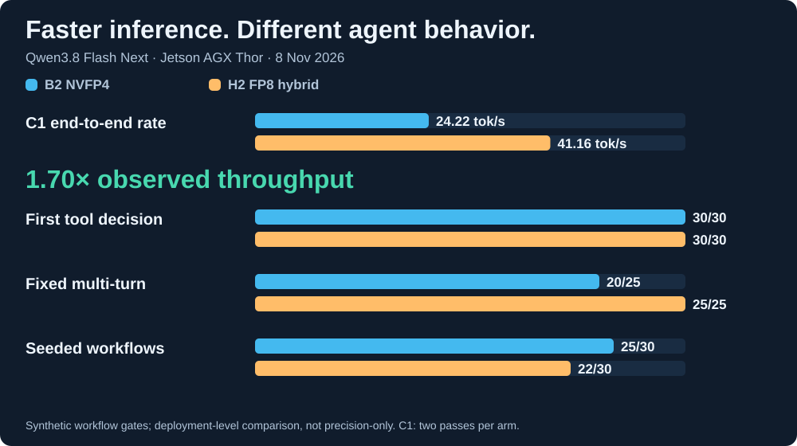
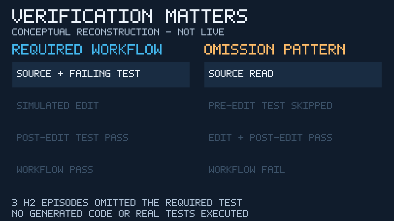
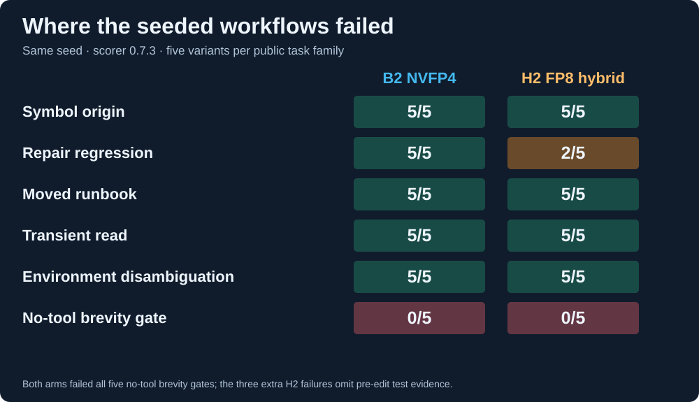
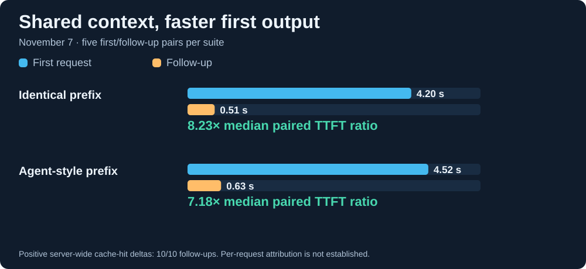
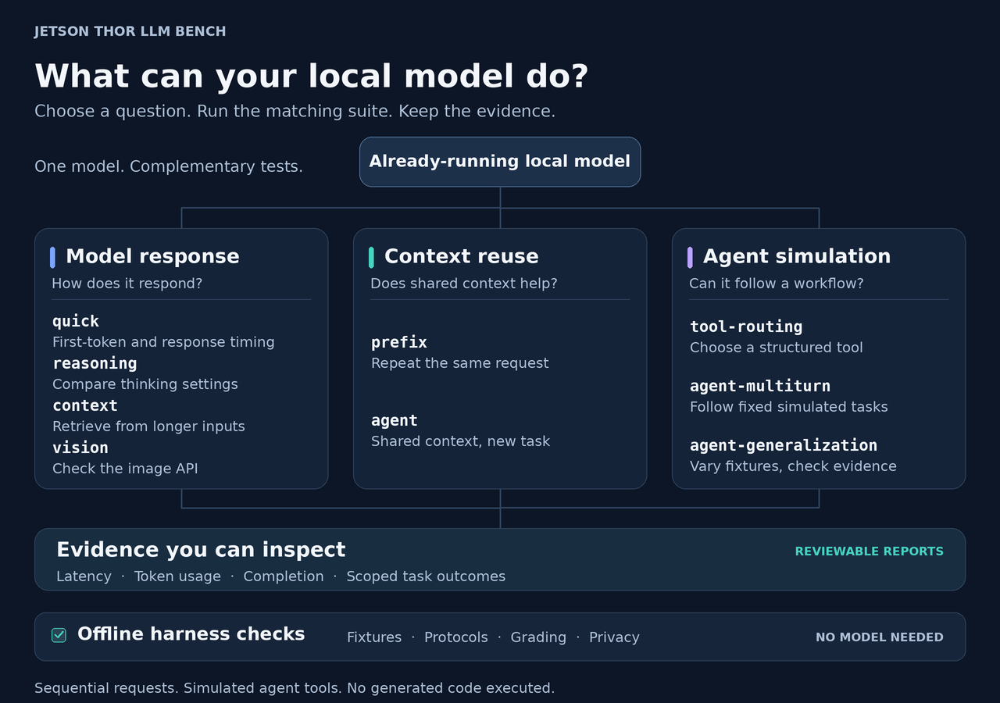

# Jetson Thor LLM Bench ⚡

**Benchmark inference speed. Measure agent behavior. Understand the trade-offs.**

Nine reproducible benchmark suites for local LLM/VLM inference on NVIDIA Jetson AGX Thor. Use an existing vLLM OpenAI-compatible endpoint with Python's standard library. No model download or server restart is required by the benchmark harness.

[Results](#benchmark-results) · [Workflow demo](#why-verification-matters) · [Quick start](#quick-start) · [All nine suites](#benchmark-suites) · [Reproduce](docs/OPERATIONS.md) · [File index](docs/INDEX.md)

## Benchmark results

**Does faster inference make a better agent?** On one 128 GB Jetson AGX Thor, two Qwen3.8 Flash Next deployments achieved **24.22 vs 41.16 tok/s** on the same public C1 throughput protocol. The faster deployment completed fewer seeded repair workflows.



| November 8, 2026 | B2 NVFP4 | H2 FP8 hybrid |
|---|---:|---:|
| **C1 end-to-end throughput** | **24.22 tok/s** | **41.16 tok/s** |
| First-decision routing | 30/30 | 30/30 |
| Fixed multi-turn completion | 20/25 | 25/25 |
| Seeded workflow completion (scorer 0.7.3) | 25/30 | 22/30 |
| **Seeded repair regression** | **5/5** | **2/5** |
| Median seeded episode time, all outcomes | 17.70 s | 9.13 s |
| Reported model-loading memory | 97.84 GiB | 76.75 GiB |
| Estimated board-input energy, nine-suite window | 26.49 Wh | 14.75 Wh |

**What this demonstrates:** a 1.70× observed end-to-end throughput difference between whole deployments, with a workflow-compliance trade-off. Checkpoints, runtime, tool parser and speculative decoding differ; this is not an isolated FP8-versus-FP4 comparison. C1 includes prefill and reasoning tokens, and does not grade answer correctness. Agent tests use simulated tools, not real code execution. Small samples and different work performed prevent a general model ranking or equal-correctness energy claim.

[Full comparison and failed startup](docs/benchmarks/2026-11-08-fp8-hybrid-comparison.md) · [Numeric evidence](docs/data/fp8-hybrid-comparison.json) · [Per-workload throughput](docs/figures/throughput-by-workload.svg) · [Memory and energy](docs/figures/memory-energy.svg)

## Why verification matters



**Conceptual reconstruction, not a recording.** Three H2 seeded repair episodes omitted the required failing simulated test before editing, even though they obtained a passing post-edit simulated test. No generated code or shell commands ran. The animation illustrates that documented failure pattern, not exact event timings or a complete recorded trace.



Both deployments failed all five seeded no-tool brevity gates. H2's fixed-suite advantage came from the separate no-tool answer gate; both passed all 20 fixed tool-using episodes. The seeded repair result suggests testing a trusted runner that enforces verification before edits. That experiment has not been run.

[Detailed failure interpretation](docs/benchmarks/2026-11-08-fp8-hybrid-comparison.md#what-the-failures-mean) · [Seeded protocol](docs/AGENT_GENERALIZATION_EVAL.md) · [Static workflow diagram](docs/figures/verification-workflow.svg)

## Shared context, faster first output



In the separate November 7 study, five identical-prefix pairs showed a median paired TTFT ratio of **8.23×**, and five synthetic agent-style pairs showed **7.18×**. All ten follow-ups had positive server-wide cache-hit counter deltas. These are responsiveness results, not a decoding-speed multiplier or definitive per-request cache attribution.

[Animated measured summary](docs/figures/prefix-responsiveness.gif) · [Exact pair observations](docs/benchmarks/2026-11-07-shockwave-five-pair-prefix-agent.md) · [Cache evidence workflow](docs/diagrams/08-prefix-cache-evidence.md) · [Agent-prefix sequence](docs/diagrams/09-agent-prefix-sequence.md)

## Benchmark suites



| Suite | Measures | What it does not claim |
|---|---|---|
| `quick` | Streaming TTFT, TTFC, rates, response latency | Coding correctness |
| `reasoning` | Off / low / medium on the same prompt | Equal-quality outputs |
| `context` | Synthetic retrieval at increasing lengths | Full configured-context validation |
| `vision` | Image API response completeness | Visual accuracy |
| `prefix` | First/repeat pairs and optional cache counters | Per-request cache proof |
| `agent` | Shared context with changed user tasks | Tool execution or coding accuracy |
| `tool-routing` | Function selection and argument accuracy | Executed tools |
| `agent-multiturn` | Fixed simulated workflows and recovery | Real repository modifications |
| `agent-generalization` | Seeded fixture variants, decoys and evidence gates | Held-out real-repository correctness |

[Visual guide](docs/BENCHMARK_VISUAL_GUIDE.md) · [Animated suite map](docs/figures/benchmark-proposal.gif) · [All workflow diagrams](docs/diagrams/README.md)

## Quick start

Python 3.10+ and an already running compatible vLLM server are required. Use a local endpoint. Do not expose it publicly or start another large model when memory is constrained.

```bash
python3 -m unittest discover -s tests -v
python3 -m thorbench doctor
python3 -m thorbench bench --suite quick --runs 3
python3 -m thorbench.tool_eval --runs 2
python3 -m thorbench.generalize_eval --runs 1
```

Set `THOR_BENCH_BASE_URL` and `THOR_BENCH_MODEL` as needed. Check the current endpoint, memory and actual deployment before running. A historical configuration is not proof of the active configuration. The default endpoint is localhost; the API key, if required, is read from `THOR_BENCH_API_KEY`. Raw results are ignored by Git.

[Step-by-step operations guide](docs/OPERATIONS.md) · [Serving profiles](docs/SERVING_PROFILES.md) · [Model integrations](models/README.md) · [Methodology](docs/METHODOLOGY.md)

## Reproduce the figures and inspect the evidence

```bash
node scripts/render_publication.cjs
```

The optional Node renderer needs no GPU, weights or private results. It creates SVG charts, a PNG social image, two GIFs and a SHA-256 provenance manifest. Older figures retain their original renderers. See [visual provenance](docs/FIGURE_PROVENANCE.md) and [file index](docs/INDEX.md).

## What you can learn

| Goal | Start here |
|---|---|
| Deploy the model safely | [B2 and H2 deployment profiles](docs/SERVING_PROFILES.md), [H2 guide](models/qwen3.8-flash-next-fp8-hybrid/README.md) |
| Understand every benchmark | [Visual guide](docs/BENCHMARK_VISUAL_GUIDE.md), [methodology](docs/METHODOLOGY.md) |
| Reproduce speed and agent outcomes | [Full comparison](docs/benchmarks/2026-11-08-fp8-hybrid-comparison.md), [operations](docs/OPERATIONS.md) |
| Understand cache and memory limits | [Optimization matrix](docs/OPTIMIZATION_MATRIX.md), [memory experiment](docs/MEMORY_AB_EXPERIMENT.md) |
| Inspect historical scorer changes | [Generalization protocol](docs/AGENT_GENERALIZATION_EVAL.md), [historical results](docs/AGENT_GENERALIZATION_RESULTS.md) |
| Extend the study | [Guarded verification proposal](docs/benchmarks/2026-11-08-fp8-hybrid-comparison.md#next-controlled-study-agents-with-externally-enforced-verification), [quality roadmap](docs/issues/standardized-quality-evaluations.md) |

**Status:** package v0.7.0 includes generalization scorer 0.7.3, protocol 1. Historical scorer 0.7.2 results are kept separately. The November 8 matched comparison is historical, not a new live measurement. See [release workflow](docs/RELEASING.md) and [changelog](CHANGELOG.md).

## References and license

Independent personal benchmarking study, not affiliated with NVIDIA, Qwen or vLLM. See [public comparison methodology and references](docs/PUBLIC_BENCHMARKS.md), [NVIDIA Jetson AI Lab](https://www.jetson-ai-lab.com/models/qwen3-8-flash-next/) and [vLLM documentation](https://docs.vllm.ai/en/stable/serving/online_serving/openai_compatible_server/).

[MIT](LICENSE) applies to the benchmark source. Model and runtime components retain their own licenses.
