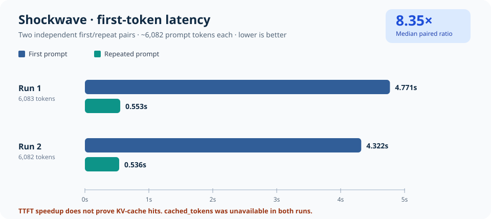
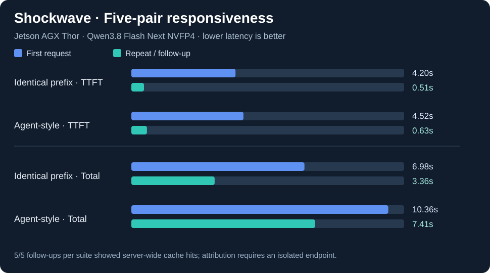

# Jetson Thor LLM Bench ⚡

**A minimal, reproducible, public-ready benchmark harness for local LLM/VLM inference on NVIDIA Jetson AGX Thor.** Designed around an existing vLLM OpenAI-compatible server; no dependencies beyond Python's standard library.

> **Status:** v0.5.0 candidate · Prototype (test tool routing on the existing Docker container before any memory A/B restart). Not affiliated with NVIDIA, Qwen, or vLLM.

## Why this repository?

Large, quantized MoE models now run on single 128 GB unified-memory devices, but "it boots" is different from measuring **first-token latency, visible-answer latency, sustained decoding, reasoning overhead and context reliability**. This repository records those dimensions without committing private prompts, device identifiers, or model files.

### Suites

| Suite | Measures | What it does *not* claim |
|---|---|---|
| `quick` | Streaming TTFT, TTFC, generation throughput, latency | A standardized coding score |
| `reasoning` | Off / low / medium on the same prompt | Identical output quality across modes |
| `context` | Needle-in-haystack correctness at increasing approximate lengths | Full native context validation |
| `vision` | Local image request / response completeness | Visual accuracy or camera FPS |
| `prefix` | Independent first/repeat pairs, optional `/metrics` cache counters, TTFT/TTFC | That faster repetition proves cache was used |
| `agent` | Long shared repository context with changing user task, optional cache evidence | A full coding-agent correctness or tool-use benchmark |
| `tool-routing` | Real structured function selection and argument accuracy against six synthetic fixtures | Actual code execution or multi-step agent task completion |

## Prerequisites

- Python **3.10+** (`python3` is enough; no pip install required).
- An **already running** vLLM OpenAI-compatible service, e.g. Qwen3.8 Flash Next on Thor, bound to `127.0.0.1:8000`.
- Adequate free memory. Benchmark code is lightweight; **the model is not**.
- Run on Shockwave's terminal for localhost access. With SSH from another machine, use SSH tunneling rather than publicly exposing the API.

## Quick start on Shockwave

```bash
cd ~/Documents/jetson-thor-llm-bench
python3 -m unittest discover -s tests -v   # offline tests
python3 -m thorbench doctor                 # vLLM health, model, context, platform info
python3 -m thorbench bench --suite quick --runs 3
cat results/*-quick/summary.md
```

This does **not** restart the currently working container and does **not** download weights.

### Model provenance and public results

```bash
python3 -m thorbench doctor       # local model name, checkpoint, configured context
python3 -m thorbench references   # external source catalog (offline)
python3 -m thorbench compare --run results/<timestamp>-quick
```

The first supported model is **Qwen3.8 Flash Next**, served as `Qwen3.8-Flash-Next`, with checkpoint `local-inference-lab/Qwen3.8-Flash-Next-NVFP4`. Public references include the [official NVIDIA Thor recipe](https://www.jetson-ai-lab.com/models/qwen3-8-flash-next/), [Leibniz-HBI's vLLM Thor report](https://github.com/Leibniz-HBI/Qwen3.8-Flash-Next-Jetson-Thor-vLLM), and an [NVIDIA forum FP8-hybrid result](https://forums.developer.nvidia.com/t/qwen3-8-flash-next-at-46-7-tok-s-on-jetson-agx-thor/383269). **These are not matched head-to-head results.** See [public comparison methodology](docs/PUBLIC_BENCHMARKS.md).

The model-specific deployment guide and launch script live under [`models/qwen3.8-flash-next/`](models/qwen3.8-flash-next/README.md). Future model integrations should follow the same directory convention.

### Reproducing the **actual** launch configuration

The validated baseline is checked in as [full `docker run` recipe](models/qwen3.8-flash-next/serve.sh) plus [machine-readable deployment profile](models/qwen3.8-flash-next/launch-profile.json) (image digest at pull, all Docker runtime/volume/environment options and all vLLM arguments). The script is **not automatically executed** by benchmarks. Actual running flags can differ from this declaration; capture them safely using Docker inspection:

```bash
python3 -m thorbench doctor --container qwen38-flash-next
python3 -m thorbench bench --suite quick --runs 3 --container qwen38-flash-next
# Structured metadata.json includes deployment.vllm_flags, prefix_caching_flag and declared_launch_profile.sha256.
# Neither command restarts Docker nor copies prompts, raw env, bind mounts or credentials.
```

If a container cannot be inspected, omit `--container` for normal testing; never pretend the declared recipe is the observed live configuration. Unknown effective defaults are marked *not explicitly set*, not "off". Checkpoint revision, image digest, power and clocks still require independent confirmation. Read [optimization matrix](docs/OPTIMIZATION_MATRIX.md) and [feature workflow diagrams](docs/diagrams/README.md) before modifying flags.

### Observed prefix responsiveness on Shockwave (2026-11-07)



Two operator-supplied historical pairs, each with ~6,082 actual prompt tokens, show **8.63×** and **8.06×** faster TTFT on repetition. These are *observed short runs*, not a statistically established improvement or verified cache reuse: `cached_prompt_tokens` was **missing** for all four calls. See the [full numeric case study](docs/benchmarks/2026-11-07-shockwave-prefix.md), [evidence-gating workflow](docs/diagrams/08-prefix-cache-evidence.md), and [agent-style follow-up sequence](docs/diagrams/09-agent-prefix-sequence.md).

### Five-pair live benchmark: prefix + changing agent tasks



The next controlled run completed **20/20 requests**: identical-prefix first/repeat median paired TTFT ratio **8.23×**, and synthetic agent-style follow-up **7.18×** (five pairs each). All ten follow-ups showed **positive server-wide prefix-cache hit-counter deltas**, stronger evidence than latency alone but not definitive per-request attribution without an isolated endpoint. Decoding remained near **24–25 tokens/s**. Read the [five-pair benchmark and caveats](docs/benchmarks/2026-11-07-shockwave-five-pair-prefix-agent.md). These are *responsiveness*, not code-correctness, results.

### Repeated-pair and agent-like probes (no restart)

```bash
# Five independent repeat pairs; no warmup inside these paired workloads:
python3 -m thorbench bench --suite prefix --runs 5 --warmup 0 \
  --prefix-tokens 8192 --container qwen38-flash-next
# Different user request, stable long system/repository prefix:
python3 -m thorbench bench --suite agent --runs 5 --warmup 0 \
  --prefix-tokens 8192 --container qwen38-flash-next
```

The benchmark attempts read-only `/metrics` scrapes before/after each request and reports **server-wide prefix cache counter deltas** when available. `None` means unavailable, *not* zero hits. Other clients can contaminate attribution; see the [reproducible agent/prefix protocol](docs/AGENT_BENCHMARK_PROTOCOL.md). The `agent` suite is a synthetic responsiveness probe, not proof of correct code execution.

Or run the original short smoke sequence: `bash scripts/benchmark_baseline.sh`. The current launch script does not explicitly select prefix caching, and engine defaults vary. Do not equate these results with [Marco's 46.7 tok/s](https://forums.developer.nvidia.com/t/qwen3-8-flash-next-at-46-7-tok-s-on-jetson-agx-thor/383269) or [Ryan's real coding-agent trials](https://forums.developer.nvidia.com/t/qwen3-8-flash-next-at-46-7-tok-s-on-jetson-agx-thor/383269/6).


### First-decision coding-agent tool routing (no Docker restart)

```bash
python3 -m thorbench.tool_eval --runs 2
cat "$(ls -td results/*-tool-routing | head -1)/summary.md"
```

This uses **real model function-calling responses**, but never executes model-selected tools or shell commands. It scores six deterministic cases (including a no-tool negative control) and records timing without publishing prompts or generated arguments. See [tool-routing protocol](docs/AGENT_TOOL_EVAL.md), [decision workflow](docs/diagrams/10-agent-tool-evaluation.md), and the [memory/KV-cache A/B restart plan](docs/MEMORY_AB_EXPERIMENT.md). **Keep the current Docker container running until the baseline is recorded and the optional restart is explicitly scheduled.**

### Reasoning-mode comparison

```bash
python3 -m thorbench bench --suite reasoning --runs 2
```

All modes use the same coding prompt. Note that `enable_thinking=false` depends on support from the chosen Qwen model and chat template; any rejected request will be shown as a failure, not silently retried with a different setting.

### Context reliability (start small)

```bash
python3 -m thorbench bench --suite context --runs 1 --warmup 0
# More demanding (opt in after watching memory in jtop):
python3 -m thorbench bench --suite context --context-sizes 16384,32768 --runs 1 --warmup 0
# MUCH later: deliberately opt in to large tests:
# python3 -m thorbench bench --suite context --context-sizes 65536 --allow-large-context --runs 1 --warmup 0
```

Targets are approximate; see `prompt_tokens` for the server's actual count. The context suite stops after the first failure. **Do not start with a 212K input** just because `/v1/models` reports a 212,992-token maximum.

### Vision request

```bash
python3 -m thorbench bench --suite vision --image ~/Pictures/test.jpg --runs 1 --warmup 0
```

Use your own test image. It is sent in memory as a data URI and is **not persisted** in the benchmark results. The test checks API response success, not whether the description is accurate.

## Outputs

Each run creates a timestamped folder below `results/` with:

- `metadata.json` — model name, advertised context, non-identifying Jetson software information and a checked-in launch-profile hash; **sanitized actual Docker flags** appear when `--container` is supplied.
- `samples.jsonl` — request timing, token counts, pass/fail, and any errors. **No prompt or generated answer content.**
- `summary.md` and `summary.json` — scenario-level median latency, TTFT, TTFC, throughput and pass counts; for paired suites, an additional per-pair comparison and median ratio.
- `cache_evidence` and cache-query/hit counter deltas in paired `samples.jsonl` when exposed by the server; **counters are server-wide**, not request-specific.

**Everything under `results/` is ignored by Git.** To publish an anonymized benchmark, inspect it and explicitly copy only the fields you want to share to a tracked document.

## Running against other models

```bash
THOR_BENCH_BASE_URL=http://127.0.0.1:8000 \
THOR_BENCH_MODEL=Qwen3.8-Flash-Next \
python3 -m thorbench bench --suite quick
```

Optional `THOR_BENCH_API_KEY` is read from the environment, never stored in reports. Avoid entering it directly into tracked files.

## Reproducing the initial Thor container (optional)

`models/qwen3.8-flash-next/serve.sh` records the baseline launch flags: `GPU_MEMORY_UTILIZATION=0.90`, `MAX_MODEL_LEN=212992`, `--max-num-seqs 1`, and **MTP disabled**. Do **not** run it while your working vLLM container is already active. It is a convenience recipe, not part of benchmark execution.

The baseline includes a known missing MTP safetensors file and a KV-cache limitation at 262K: see [Shockwave baseline](models/qwen3.8-flash-next/baseline.md). Model weights and base images are not included or relicensed.

## GitHub: real PRs, version tags, issues and releases

This standalone repository maintains `main` through pull requests and release tags. Keep this v0.3.0 candidate in a feature branch until tests and review pass; release only from merged `main`. Historical releases remain unchanged.

See [step-by-step release and PR workflow](docs/RELEASING.md), [publication checklist](docs/PUBLICATION_CHECKLIST.md), and [historical 2025–2026 memory-cache issue draft](docs/issues/2025-2026-memory-cache-pressure.md).

## Local development (existing repository)

```bash
cd ~/Documents/jetson-thor-llm-bench
python3 -m unittest discover -s tests -v
git status --short
git diff --check
```

Review `git diff`, CI and the anonymized metadata before opening a PR. Don't overwrite tags or commit raw results.

## Documentation

- [Optimization and feature status matrix](docs/OPTIMIZATION_MATRIX.md) and [Mermaid workflow diagrams](docs/diagrams/README.md)
- [Methodology and caveats](docs/METHODOLOGY.md)
- [Qwen3.8 Flash Next model guide](models/qwen3.8-flash-next/README.md) and [observed Shockwave baseline](models/qwen3.8-flash-next/baseline.md)
- [Public benchmark comparisons and standardized quality roadmap](docs/PUBLIC_BENCHMARKS.md)
- [Releases, PRs and issue publication](docs/RELEASING.md)
- [Published Shockwave prefix case study](docs/benchmarks/2026-11-07-shockwave-prefix.md) — measured data, illustrated, limitations
- [Five-pair prefix and agent benchmark](docs/benchmarks/2026-11-07-shockwave-five-pair-prefix-agent.md) — measured TTFT, total latency, cache-counter evidence, graph
- [Agent/prefix benchmark protocol](docs/AGENT_BENCHMARK_PROTOCOL.md) — repeatable experiments and cache evidence
- [Tool-routing evaluation protocol](docs/AGENT_TOOL_EVAL.md) — first real tool decision, no execution
- [Memory/KV-cache A/B restart plan](docs/MEMORY_AB_EXPERIMENT.md) — rollback-first controlled experiment
- [Changelog](CHANGELOG.md)
- [Security and disclosure](SECURITY.md)
- [Contribution guidelines](CONTRIBUTING.md)

### References and credit

- [NVIDIA Jetson AI Lab — Qwen3.8 Flash Next](https://www.jetson-ai-lab.com/models/qwen3-8-flash-next/)
- [vLLM online serving documentation](https://docs.vllm.ai/en/stable/serving/online_serving/openai_compatible_server/)
- [vLLM reasoning streaming responses](https://docs.vllm.ai/en/stable/features/reasoning_outputs/)
- [Independent Thor deployment / benchmarks](https://github.com/Leibniz-HBI/Qwen3.8-Flash-Next-Jetson-Thor-vLLM) (context only; not copied code)

## License

MIT for benchmark source only. Model and runtime licenses belong to their owners.
