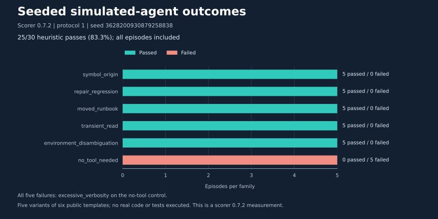
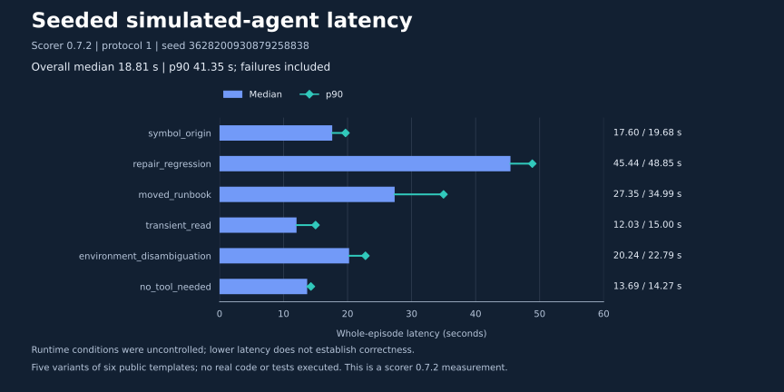

# Seeded simulated-agent results and visual guide

The latest recorded full run completed **25/30 episodes (83.3%)** with **scorer 0.7.2**, protocol 1, seed `3628200930879258838`, starting at commit `de44842`. Five variants of each of six public task families were included. All five failures were `excessive_verbosity` on the no-tool control; no request errors occurred.

Package v0.7.0 includes scorer **0.7.3**, whose numeric correction is validated offline. These charts preserve the observed 0.7.2 score; no full live-suite score is claimed here for 0.7.3.

## Outcomes by family



The no-tool model answers made zero tool calls but exceeded the unchanged 700-character cap. Those five failures remain in the denominator. A bar marked passed means the scorer's evidence and answer heuristics passed, not that real code was executed or independently verified.

## Episode latency



Overall median: **18.8132 seconds**; interpolated p90: **41.3457 seconds**. Family-level p90 values have only five observations each. These are nonstreaming whole-episode model-request times, not TTFT or per-token decoding throughput. Failures remain included. Power, clocks, thermal state, other clients and cache state were uncontrolled; development checks ran during the run. The chart supports no controlled performance ranking or causal speedup claim.

Across all episodes: **103 model turns**, **136 simulated tool calls**, **98,399 summed prompt tokens** and **14,327 completion tokens**. Prompt totals repeat conversation history across turns; they are not unique context tokens. The [full investigation note](benchmarks/2026-11-08-generalization-followup.md#fresh-versioned-live-run-scorer-072-2530) includes per-family usage and provenance.

## Test coverage and workflow

- [Test-family diagram](diagrams/14-generalization-test-families.md): required observations, fixture state and final facts for all six families.
- [Evaluation workflow](diagrams/13-generalization-seeded-fixtures.md): oracle boundary, bounded model/tool loop, failure handling, grading and private reporting.
- [Serving-profile reference](SERVING_PROFILES.md): B2 is preferred for the current sequential workload; inspect the actual container without restarting it.
- [Scoring protocol](AGENT_GENERALIZATION_EVAL.md): version history, positive/negative gates and remaining heuristic limitations.

Earlier **4/6**, corrected **5/6** and wider **24/30** results remain separately attributed in the investigation note. They used different scorer revisions and/or seeds. They are not combined into a trend line or relabeled using a newer scorer. Fresh generated instances still belong to six public templates, not six withheld task types or unrelated software issues.

## Source data and regeneration

The figures use the reviewed [numeric-only data fixture](data/2026-11-08-generalization-observations.json), copied from selected fields of the local saved metadata and summary. The renderer never reads raw model responses or the ignored `results/` directory.

From the repository root, in a development environment with **Matplotlib** available:

```bash
python3 scripts/render_generalization_results.py
```

Matplotlib is needed only to regenerate these figures; it is not a benchmark or offline-test dependency. The tracked SVG files render on GitHub and can be downloaded independently. The script omits export timestamps and fixes SVG ID generation for reproducibility within the same rendering environment; SVG bytes can vary across Matplotlib/font versions. Offline tests check the numeric fixture and exported chart labels without importing Matplotlib.
