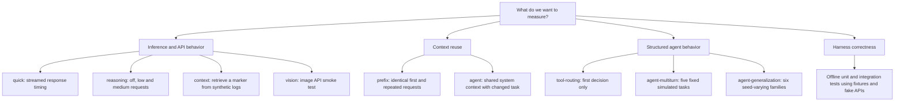
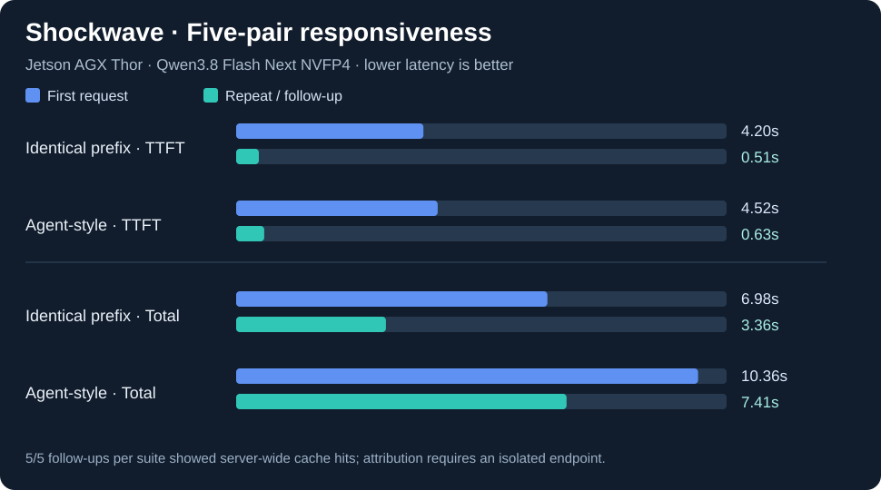
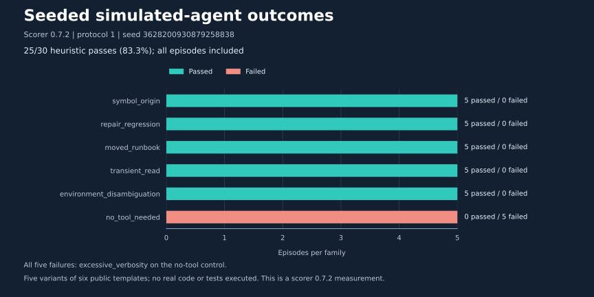

# Visual guide to every benchmark

Start here to understand what is sent to the model, what each test observes and what a PASS means. The nine live suites answer different questions. Offline tests validate the harness itself. Their scores are not interchangeable.

## Suite map and counting rules

The commands below select a test; they are not a batch to run together. Live requests are sequential. Use the existing healthy server, check its [actual serving profile](SERVING_PROFILES.md), and run only the suites needed for the question being investigated.

| Test | Entry point | What `--runs N` counts | Detailed visual |
|---|---|---|---|
| `quick` | `python3 -m thorbench bench --suite quick` | N measured requests after warmups | [Streaming timeline](diagrams/15-streaming-and-reasoning.md) |
| `reasoning` | `python3 -m thorbench bench --suite reasoning` | N measured requests **per mode**, for off/low/medium | [Reasoning experiment](diagrams/15-streaming-and-reasoning.md#reasoning-mode-workflow) |
| `context` | `python3 -m thorbench bench --suite context` | N measured requests **per attempted length** | [Retrieval and stop rules](diagrams/16-context-retrieval.md) |
| `vision` | `python3 -m thorbench bench --suite vision --image image.jpg` | N measured image requests after warmups | [Image request workflow](diagrams/17-vision-smoke.md) |
| `prefix` | `python3 -m thorbench bench --suite prefix --warmup 0` | N pairs = **2N requests** | [Pair and cache evidence](diagrams/08-prefix-cache-evidence.md) |
| `agent` | `python3 -m thorbench bench --suite agent --warmup 0` | N pairs = **2N requests** | [Shared-context sequence](diagrams/09-agent-prefix-sequence.md) |
| `tool-routing` | `python3 -m thorbench.tool_eval` | N repetitions of six fixed cases = **6N requests** | [All six routing cases](diagrams/20-tool-routing-cases.md) |
| `agent-multiturn` | `python3 -m thorbench.agent_eval` | N repetitions of five fixed tasks = **5N episodes**, potentially many model requests | [Five task traces](diagrams/19-fixed-agent-test-cases.md) |
| `agent-generalization` | `python3 -m thorbench.generalize_eval` | N variants per family = **6N episodes**, potentially many model requests | [Six families](diagrams/14-generalization-test-families.md) and [execution loop](diagrams/13-generalization-seeded-fixtures.md) |
| Offline development tests | `make test` | Python test methods and their subtests | [CI and test coverage](diagrams/18-offline-test-workflow.md) |

The first six entries use `thorbench bench`. The three tool/agent quality evaluators are separate modules, not extra `bench --suite` names. `agent` is a responsiveness test; `agent-multiturn` and `agent-generalization` are simulated workflow tests.

## Quick and reasoning

**Question:** how soon does generation begin, when does visible text appear, and how long does the response take?

The quick suite repeats one public coding prompt with low reasoning effort. It records streamed TTFT, TTFC, completion time and available usage. The harness does not execute or grade the returned function. A PASS checks `finish_reason=stop`, not algorithm correctness.

The reasoning suite requests off, low and medium settings with the same prompt, temperature and per-mode output budget. Each mode has its own warmups and measured repetitions. Requested settings are not independent proof of the runtime's effective thinking behavior. Longer hidden reasoning or longer answers can increase latency without establishing worse decoding performance or better quality. See the [timing and mode diagrams](diagrams/15-streaming-and-reasoning.md).

## Context retrieval

**Question:** can the model find a known reference marker inside increasingly long synthetic logs?

Default approximate sizes are 1,024, 4,096 and 8,192 tokens, generated with a character heuristic. The API's `prompt_tokens` is the actual observed length. The current gate requires `finish_reason=stop` and the marker appearing in the answer; it does not enforce that the marker is the answer's only text. All measured repetitions for one size run before deciding whether to advance. A failed size stops later sizes. See the [complete context workflow](diagrams/16-context-retrieval.md).

Earlier B2 probes retrieved the target at **7,992** and **31,652** actual prompt tokens. These are limited observations, not validation of the configured 131,072-token maximum. See the [recorded context probes](benchmarks/2026-11-08-shockwave-b2-output-length-context.md).

## Vision API smoke test

**Question:** does the image request path complete and return visible text?

The benchmark reads the image explicitly selected by the operator, checks the filename MIME type and size, embeds it in a request, and sends it to the configured server. PASS requires a nonempty visible response with `finish_reason=stop`. There are no ground-truth visual labels, object-detection scores or image-understanding accuracy results. The input image and raw answer are not copied into reports. See the [vision workflow](diagrams/17-vision-smoke.md).

## Prefix pairs and changing-task pairs

**Question:** how does first-token responsiveness change when context is reused?

Within a `prefix` pair, the requests are identical. Within an `agent` pair, the synthetic system/repository context is shared while the user task changes. A fresh marker distinguishes each pair. Both suites require `--warmup 0`, and neither scores answer quality. See the [cache-evidence workflow](diagrams/08-prefix-cache-evidence.md) and [changing-task sequence](diagrams/09-agent-prefix-sequence.md).

The recorded study completed **10/10 requests per suite**, with median paired TTFT ratios of **8.23×** for identical requests and **7.18×** for changed tasks. All ten follow-ups had positive server-wide cache-hit deltas. These ratios describe TTFT, not a decoding-speed multiplier, and global counters do not attribute hits to an individual request when other clients may be active. See the [original paired measurements](benchmarks/2026-11-07-shockwave-five-pair-prefix-agent.md).

## First-decision tool routing

**Question:** does the first response select the expected structured tool and argument, or correctly avoid a tool?

Six fixed cases cover two explicit file reads, two symbol searches, one requested test target and one no-tool control. The declarations are presented to the model; **none of the selected tools executes**. A textual imitation of a function call does not satisfy the structured-call gate. For the no-tool case, the scorer checks zero calls and nonempty text; it does not independently grade the explanation's factual accuracy or sentence count. See the [six-case map](diagrams/20-tool-routing-cases.md) and [decision workflow](diagrams/10-agent-tool-evaluation.md).

Historical A and B2 runs each passed **30/30 first decisions**, repeating those six cases. This does not establish completion of 30 independent programming tasks. See the [A/B results](benchmarks/2026-11-08-shockwave-b2-vs-a.md).

## Fixed multi-turn simulated tasks

**Question:** can the model use synthetic observations to finish a bounded workflow?

Five fixed fixtures exercise search/read, failing-test repair/retest, missing-document recovery, a temporary-read retry and a no-tool answer. Each episode receives a fresh fixture dictionary. Selected tools execute only inside that dictionary, and required event sequences plus final-answer heuristics determine the outcome. See the [five-task evidence map](diagrams/19-fixed-agent-test-cases.md) and [model/tool loop](diagrams/12-multi-turn-simulator.md).

The recorded **25/25** result repeats each of five public tasks five times; median episode latency was **12.2302 seconds**. It is a different protocol from seeded generalization. See the [fixed-task measurements](benchmarks/2026-11-08-shockwave-multiturn-25-episodes.md).

## Seed-varying simulated tasks

**Question:** can the model finish familiar task types when exact paths, values, decoys and fault counts vary?

The base seed and family/repetition index deterministically generate the fixture and local oracle. Six families add active/archived/staging disambiguation, bounded recovery, repair and a no-tool control. The oracle remains outside the model messages. See the [six-family map](diagrams/14-generalization-test-families.md), [execution workflow](diagrams/13-generalization-seeded-fixtures.md) and [visual results guide](AGENT_GENERALIZATION_RESULTS.md).

The recorded **25/30** full run used scorer **0.7.2**, protocol 1 and seed `3628200930879258838`. All five failures were excessive verbosity in the no-tool control. Released package v0.7.0 contains scorer **0.7.3**, whose numeric correction has offline regression coverage; that does not reattribute the older live score to 0.7.3. The [latency chart](figures/agent-generalization-latency-2026-11-08.svg) and [full numeric note](benchmarks/2026-11-08-generalization-followup.md) preserve this distinction.

The later [B2/H2 deployment comparison](benchmarks/2026-11-08-fp8-hybrid-comparison.md) reran all nine suites under one frozen protocol and scorer 0.7.3: seeded completion was **25/30 for B2 and 22/30 for H2**. Its separate forum C1 throughput result was **24.22 / 41.16 tok/s**. The report includes outcome/latency graphs, the original hybrid preflight that never served requests, and the conservative profile that completed measurement. Keep these results separate from the historical scorer 0.7.2 charts above.

## Offline tests and serving experiments

**Offline tests validate the implementation.** They check transport parsing, scenarios, cache counters, simulator safety, scoring, reporting, version declarations, public figure provenance and paired-comparison integrity. Integration tests use fake API responses, not the local model. The current documented baseline is **107 passing Python tests**; this is a harness test count, not 107 successful model tasks. See the [offline coverage map](diagrams/18-offline-test-workflow.md).

**Serving A/B experiments validate a configuration under the tested conditions.** They are separate from the task suites. The earlier 4 GiB / 0.90 candidate failed startup; B2 at 0.88 started and completed the reported smoke tests. Context, KV reserve and utilization changed together, and memory was sampled at different times. See the [A-to-B2 experiment diagram](diagrams/11-memory-budget-restart.md), [profile commands and features](SERVING_PROFILES.md) and [memory study](MEMORY_AB_EXPERIMENT.md). Among the NVIDIA A/B2 profiles, B2 remains preferred, with sustained stability and full context still unvalidated.

## How to read a report

Follow the [report interpretation diagram](diagrams/21-results-and-evidence.md). Check the suite and protocol before comparing a number, then inspect failures, token lengths, units and runtime conditions.

| Report family | Pass denominator | Latency aggregation |
|---|---|---|
| `bench` suites | Every recorded request, including failures; warmups excluded | Per-scenario medians use successful rows. A paired ratio requires a completed first/follow-up pair and usable TTFT values |
| `tool_eval` | All attempted first-decision cases | Numeric timings from both passes and failures are included |
| `agent_eval` / `generalize_eval` | All attempted episodes, including request errors | Numeric episode timings from passes and failures are included; prompt usage sums repeated history |

Missing usage, timings or counters are unavailable, not zero. The basic request suites' `finish_reason=length` means incomplete output; the separate first-decision scorer evaluates structured calls instead of applying that completion gate. Do not interpret a response-completion pass, a routing pass and a simulated-task pass as the same kind of success.

Review [metadata, samples and summaries](diagrams/21-results-and-evidence.md#report-files) together. Only selected, reviewed numeric evidence is published; raw images, prompts, model answers, generated arguments and private container metadata stay out of public artifacts. Different scorer versions, seeds, task templates, serving profiles and uncontrolled conditions prevent causal rankings from these historical results.
