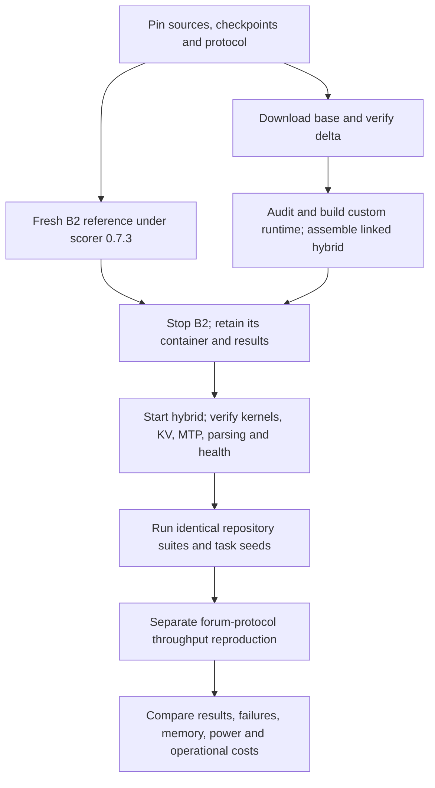

# Second benchmark: Qwen3.8 Flash Next FP8 hybrid

**Status: paired B2/H2 measurements complete; original H1 preflight aborted.** The [comparison report](benchmarks/2026-11-08-fp8-hybrid-comparison.md) records all nine suites and the separately pinned forum C1 test: **24.22 / 41.16 tok/s** for B2/H2, with mixed workflow outcomes. H1 never reached API readiness, so it has no scored-suite or throughput result. This is a second checkpoint/runtime configuration of the same model family. Any observed difference belongs initially to the complete deployment, not to FP8 quantization alone.

### Local preflight profiles

| Profile | GPU budget | KV allocation | Context / sequences | Observed status |
|---|---|---|---|---|
| B2 reference | `0.88` | Explicit 4 GiB | `131072` / 1 | Nine suites and two-pass C1 complete |
| H1: pinned recipe defaults | `0.90` | Automatic; startup allocated 27.31 GiB | `262144` / 3 | Aborted before API readiness; no hybrid benchmark requests sent |
| H2: measured conservative profile | `0.88` | Explicit 4 GiB | `131072` / 1 | One planned restart and paired measurements complete; MTP 3 and custom kernels retained |

H1 loaded target/MTP weights and reported 76.75 GiB model memory, selected the expected FP8/GDN kernels and allocated KV, then stopped making visible startup progress. GPU status tools and the display subsequently blocked in the driver; the kernel recorded interrupt warnings and blocked tasks. Stopping the retained container restored GPU-query responsiveness and released memory. The container's OOM flag was false; its exit 137 followed the deliberate stop timeout. A driver allocation error at cleanup does not establish the initial cause. This is an aborted operational preflight, not a measured 0 tok/s result or proof that the recipe cannot work elsewhere.

H2 matches B2's memory/context/scheduler limits and initially used fresh runtime caches. It is an adaptation, not an exact replication of the forum serving defaults. GPU probes guarded preflight and stopped before timed suite measurement. H2 reached readiness, passed one planned stop/start cycle, and completed the protocol. Use the [H2 build and launch guide](../models/qwen3.8-flash-next-fp8-hybrid/README.md) and [structured profile](../models/qwen3.8-flash-next-fp8-hybrid/launch-profile.json); retain H1's unsuccessful preflight in any account of the experiment.

## Reproduction target

Use an immutable snapshot of the [custom Thor recipe](https://github.com/pastoriomarco/NemoClaw-Thor/blob/dd07dcc2f5650916e18e2c706144c6fd1f8bf13c/serving/docs/QWEN38-FLASH-NEXT-FAST-THOR.md), rather than combining settings from different posts.

| Artifact | Pin or required configuration |
|---|---|
| Recipe source | `pastoriomarco/NemoClaw-Thor` at `dd07dcc2f5650916e18e2c706144c6fd1f8bf13c` |
| Base weights | [RadixArk/Qwen3.8-Flash-Next-NVFP4](https://huggingface.co/RadixArk/Qwen3.8-Flash-Next-NVFP4/tree/7b719225242aacd3dbd3f9407468c2ee9a9d2594), revision `7b719225242aacd3dbd3f9407468c2ee9a9d2594` |
| Converted weights | [FP8 hybrid delta](https://huggingface.co/pastoriomarco/Qwen3.8-Flash-Next-NVFP4-FP8-Hybrid-Delta/tree/358162ffaaeb4372c79843d9cd1f67d3654593da), revision `358162ffaaeb4372c79843d9cd1f67d3654593da` |
| Runtime | Locally built `nemoclaw-thor/qwen38-flash-next-vllm:sm110-fast-v3`; record resulting image ID and source pins |
| Current recipe defaults | MTP 3, three scheduler slots, context `262144`, GPU memory fraction `0.90`, BF16 recurrent state and recipe KV setting `auto` (verify resolved BF16) |
| Additional runtime changes | Fused GDN decode, PLE mmap/read optimizations, reduced MTP draft vocabulary, explicit prefix caching and chunked prefill, `qwen3_coder` tool parser |
| Compilation workaround | Preserve `VLLM_DISABLE_COMPILE_CACHE=1` and `VLLM_USE_AOT_COMPILE=1`; check startup and restart behavior |

The image name above is a local build target, not an available image to pull. The existing NVIDIA image is suitable for downloading files; it is not a substitute for the custom runtime during reproduction. The base checkpoint includes embedded MTP weights, so this recipe does not need the separate drafter shard missing from the original deployment.

The [opening forum post](https://forums.developer.nvidia.com/t/qwen3-8-flash-next-at-46-7-tok-s-on-jetson-agx-thor/383269/1), current recipe and delta model card describe multiple historical settings. In particular, the delta card attributes the published 46.7 tok/s measurement to `0.92` utilization and four slots, while the pinned recipe now defaults to `0.90` and three slots. The [agent field report](https://forums.developer.nvidia.com/t/qwen3-8-flash-next-at-46-7-tok-s-on-jetson-agx-thor/383269/6) additionally discusses fixed 8 GiB KV and a 90 W power mode. These are separate configurations. Start with the pinned current recipe; label any historical-throughput replication or fixed-KV/power experiment separately. Do not call an adjusted configuration an exact replication of all reported results.

## Download without local quantization

The delta replaces four shards and an index; it cannot serve independently. Downloading it avoids local conversion, though elapsed time depends on the network. Metadata checked on November 8, 2026 reported about **125.96 GiB base + 12.23 GiB delta**. Allow additional space for the linked assembly and Docker builds. The existing `local-inference-lab` checkpoint has not been established as byte-identical to this pinned base and must not be silently substituted.

From this repository root, use the already cached NVIDIA image to download without allocating a GPU:

```bash
bash models/qwen3.8-flash-next-fp8-hybrid/download.sh
docker logs --follow --tail 50 qwen38-fp8-hybrid-download
# Ctrl+C exits the log viewer and leaves the download running.
```

The helper uses a separate `$HOME/.cache/thorbench-fp8-hybrid` directory, pins both Hub revisions and verifies the five changed files against the delta manifest, including base identity, sizes and SHA256 hashes. The original serving cache is preserved. Set `HF_CACHE` to override the download path; it must be writable by the host user. It downloads checkpoint data without executing remote model code. No hybrid assembly, inference or image build occurs. It uses two download workers and retains the download container and logs. Inspect completion with:

```bash
docker inspect --format 'running={{.State.Running}} exit={{.State.ExitCode}}' qwen38-fp8-hybrid-download
```

An exit code of zero after termination and the final verification message establish staging completion. If interrupted or failed, inspect logs and then use `docker start qwen38-fp8-hybrid-download` to resume cached downloads. The delta staging directory is `$HOME/.cache/thorbench-fp8-hybrid/deltas/pastoriomarco--Qwen3.8-Flash-Next-NVFP4-FP8-Hybrid-Delta/358162ffaaeb4372c79843d9cd1f67d3654593da`. Keep weights, raw logs and caches out of Git.

## Execution order and integrity gates

The [paired-run helper](../scripts/run_deployment_benchmarks.py) runs all nine existing suites without changing their scoring. It requires a fresh output directory below ignored `results/`, checks API health first and records commands, checkpoint revision, image ID, source hashes and vision-image hash. Optional `tegrastats` telemetry is stopped with the run. It preserves reports from failed requests and refuses to overwrite an existing run.

The frozen common protocol uses three measured repetitions and one warmup per scenario for quick, reasoning, context and vision; context targets are 8,192 and 32,768 approximate tokens. Prefix and agent responsiveness each use five first/follow-up pairs with an 8,192 approximate-token prefix and no warmup. Tool routing and fixed multi-turn tasks use five repetitions; seeded generalization uses five variants per family and seed `3628200930879258838`. Request limits remain those shown below. Vision uses `docs/figures/benchmark-proposal.png` as a shared API smoke fixture, without an accuracy score. Prefix-pair markers remain random by design, so these prompts are not byte-identical across deployments.

For example, once the pinned B2 server is healthy:

```bash
python3 scripts/run_deployment_benchmarks.py \
  --base-url http://127.0.0.1:8000 --model Qwen3.8-Flash-Next \
  --container qwen38-flash-next \
  --checkpoint-revision 6c01ac378d22f6652c9f392c87700496eca8e5dc \
  --results-dir results/deployment-comparison/b2
```

Repeat against the verified hybrid endpoint/model/container with a new output directory and its pinned base/delta revisions. `--dry-run` prints the commands without invoking Docker or the API. The separate forum `sgbench` C1 run uses upstream script revision `584c3e6e6476cb81e913d5b059f12a0b2c4c794d` (SHA256 `5328e80dd3f8a7115b8732ce313a93faf3078438949085e3b086a83c183d9eaa`), changing only the endpoint port in local copies. It makes two passes with category-specific output caps and the server's default thinking behavior; these results must remain separate from the repository suites.



1. Record the benchmark Git commit, scorer/protocol versions, checkpoint revisions, runtime image ID, startup configuration, software versions, power/clocks, temperatures and background activity. Capture sanitized deployment observations with `python3 -m thorbench doctor --container qwen38-flash-next`. Preserve historical measurements and their original scorer identifiers.
2. Run a fresh B2 reference under scorer **0.7.3** before changing deployments. Use the same nine repository suites, prompts, repetitions, warmups, thinking settings, request limits and images on both deployments. Use only lengths supported by both profiles for the common comparison. A scored vision comparison needs an identical image and grading protocol; an API smoke alone measures response success.
3. Build from audited pinned sources and assemble the downloaded delta using the pinned upstream apply helper, with `HF_CACHE="$HOME/.cache/thorbench-fp8-hybrid"`. That helper validates the manifest again before creating the linked hybrid snapshot and `.prepared` marker. Never mark a partial download as prepared. Keep original snapshots intact. No other existing repository needs to be changed to prepare or measure this benchmark.
4. Stop B2 before loading the hybrid; start only one model server at a time. Use the upstream launcher's `FLASHNEXT_DETACH=1 FLASHNEXT_NO_RM=1` options for retained background serving. Its default API is port 8050, model ID `qwen3.8-flash-next`, and bind address `0.0.0.0`; account for this network exposure when preparing the final command. A localhost-only adaptation must be recorded. Run local kernel tests and check restart health, resolved KV precision, FP8 layer dispatch, MTP acceptance, tool parsing and available memory before measurement. Record failures as outcomes. Cache clearing is not part of timed runs.
5. Run the repository comparison sequentially even though the hybrid permits three slots. Keep scorer, seed and request budgets fixed. For example, run the same seeded command against each endpoint, changing only endpoint/model ID and output directory:

```bash
python3 -m thorbench.generalize_eval \
  --base-url http://127.0.0.1:8000 --model Qwen3.8-Flash-Next \
  --runs 5 --seed 3628200930879258838 \
  --max-turns 10 --max-tokens 1024 --timeout 600 \
  --results-dir results/comparison-b2

# Run only after the hybrid has been prepared, launched and verified:
python3 -m thorbench.generalize_eval \
  --base-url http://127.0.0.1:8050 --model qwen3.8-flash-next \
  --runs 5 --seed 3628200930879258838 \
  --max-turns 10 --max-tokens 1024 --timeout 600 \
  --results-dir results/comparison-fp8-hybrid
```

6. If reproducing the forum throughput claim, separately pin the `sgbench` script revision/hash and use its exact prompts, output limits, thinking behavior, warmup and token-weighted end-to-end metric on both deployments. Report TTFT, decode estimates and aggregate throughput separately. Run concurrency experiments separately from the sequential comparison. Do not divide historical one-request B2 measurements by the forum's 46.7 tok/s.
7. Publish a comparison only after paired runs exist. Include pass/fail counts and failure categories, token counts, task latency, TTFT, cache evidence, memory snapshots, power/throttling, restart behavior, download/build cost, storage needs, context limits and configuration differences. Treat uncertain quality differences as uncertain. An optional original-RadixArk-versus-hybrid run within the same custom runtime is needed to better isolate the weight-conversion effect.

The seeded fixtures are public template variants. Results do not establish held-out coding correctness or production reliability. The historical 25/30 remains a scorer **0.7.2** result and cannot substitute for the new paired reference.
