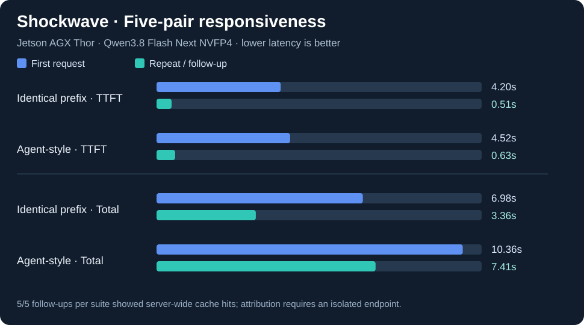

# Shockwave: five-pair prefix and synthetic agent responsiveness (2026-11-07)

> **Observed on NVIDIA Jetson AGX Thor 128 GB with Qwen3.8 Flash Next NVFP4.** This is a local, single-device latency case study, **not** a standardized coding-quality evaluation or a head-to-head comparison with other public Thor optimizations.



## Summary: five pairs per suite

| Metric | Identical-prefix suite | Synthetic agent-style suite |
|---|---:|---:|
| Successful requests | 10/10 | 10/10 |
| Median TTFT, first request | **4.20 s** | **4.52 s** |
| Median TTFT, follow-up | **0.51 s** | **0.63 s** |
| Median of five *paired* TTFT ratios | **8.23×** | **7.18×** |
| Median end-to-end latency, first | 6.98 s | 10.36 s |
| Median end-to-end latency, follow-up | 3.36 s | 7.41 s |
| Median first visible content (TTFC), first | 6.54 s | 9.55 s |
| Median TTFC, follow-up | 2.77 s | 4.31 s |
| Median decode, first | 24.14 tok/s | 24.54 tok/s |
| Median decode, follow-up | 24.60 tok/s | 24.58 tok/s |
| Follow-ups with `server_hits_observed` | 5/5 | 5/5 |

**Interpretation:** repeat requests show much faster time to first streamed token and moderate improvement in total latency. Decode rate stays approximately unchanged. The large TTFT ratio is **not** a decoding-speed multiplier.

## Exact pair observations (user-provided output)

The first and second request within each `prefix` pair are identical. Each `agent` pair preserves a synthetic long repository/system context but changes the user instruction.

### Identical-prefix requests

| Pair | First TTFT (s) | Repeat TTFT (s) | Paired TTFT ratio | Follow-up counter evidence |
|---:|---:|---:|---:|---|
| 1 | 4.324 | 0.507 | 8.53× | `server_hits_observed` |
| 2 | 4.111 | 0.506 | 8.12× | `server_hits_observed` |
| 3 | 4.306 | 0.511 | 8.42× | `server_hits_observed` |
| 4 | 4.096 | 0.503 | 8.15× | `server_hits_observed` |
| 5 | 4.204 | 0.511 | 8.23× | `server_hits_observed` |

### Synthetic agent-style requests

| Pair | First TTFT (s) | Follow-up TTFT (s) | Paired TTFT ratio | Follow-up counter evidence |
|---:|---:|---:|---:|---|
| 1 | 4.8351 | 0.6290 | 7.69× | `server_hits_observed` |
| 2 | 4.5619 | 0.4989 | 9.14× | `server_hits_observed` |
| 3 | 4.5201 | 0.6389 | 7.07× | `server_hits_observed` |
| 4 | 4.5229 | 0.6306 | 7.17× | `server_hits_observed` |
| 5 | 4.5185 | 0.6289 | 7.18× | `server_hits_observed` |

**Note:** The per-pair prefix timings above are rounded to three decimal places by the user's report. The ratio values are copied from the benchmark summary. The `agent` values come from the live command output, with the published ratios taken from its summary.

## Cache evidence: stronger, but still conditional

In the original two one-pair tests, `cached_prompt_tokens` was not reported. In these new five-pair tests, **all ten follow-up rows** were classified `server_hits_observed` based on **positive deltas in server-wide vLLM Prometheus cache-hit counters**.

This corroborates prefix caching far more strongly than TTFT alone. However, server-wide counters cannot unambiguously attribute hits to our test if there was other inference traffic. The user-provided summary does not include the numerical `cache_hit_tokens_delta`, `cache_query_tokens_delta`, or whether the endpoint was isolated; therefore, this document reports **hits observed on the server**, not a verified per-request hit rate. A 0.51-second TTFT on its own does not prove a cache hit.

### Confounders and limitations

- Five consecutive first/follow-up pairs per suite: small, non-randomized sample; no independent cold-cache or cache-disabled control group.
- Random markers distinguish pairs, but first-request JIT effects, OS page caching, GPU power/clocks, and scheduler effects can still influence results.
- `--prefix-tokens 8192` requests an **approximate** prompt size; the precise token counts for these new runs were not included in the supplied summary.
- The synthetic agent suite does **not** call tools, edit files, execute code, or assess coding correctness.
- Reported median end-to-end times are per-scenario medians, while `8.23×` and `7.18×` are **medians of per-pair ratios**. Do not assume they are ratios of the two median TTFTs.
- The vLLM deployment remains the working NVFP4 baseline with MTP disabled; do not compare these timings directly with an FP8-hybrid + MTP public benchmark.

## Reproduce safely

```bash
cd ~/Documents/jetson-thor-llm-bench

python3 -m thorbench doctor --container qwen38-flash-next

python3 -m thorbench bench --suite prefix --runs 5 --warmup 0 \
  --prefix-tokens 8192 --container qwen38-flash-next

python3 -m thorbench bench --suite agent --runs 5 --warmup 0 \
  --prefix-tokens 8192 --container qwen38-flash-next
```

To substantiate attribution in the next study, isolate the serving endpoint from other clients, examine `cache_hit_tokens_delta`, `cache_query_tokens_delta`, `cache_hit_rate` and actual `prompt_tokens` in your local `samples.jsonl`. Preserve local results under the Git-ignored `results/` directory; only publish reviewed numerical summaries.

See the [benchmark protocol](../AGENT_BENCHMARK_PROTOCOL.md), [prefix-cache evidence diagram](../diagrams/08-prefix-cache-evidence.md), and [shared agent-context sequence](../diagrams/09-agent-prefix-sequence.md). Historical two-pair results remain documented [separately](2026-11-07-shockwave-prefix.md).
