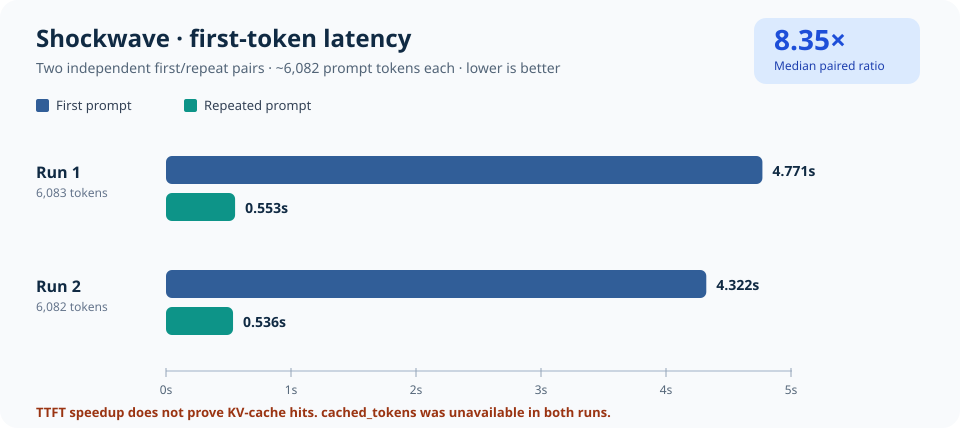

# Shockwave: observed first/repeated prompt latency (November 7, 2026)

**Status: historical observation, not proof that prefix caching was enabled or responsible.** These numbers were copied from two user-provided, private-by-default v0.3.0 runs. The curated numeric subset was approved for documentation; raw requests, outputs and device identifiers were not copied.



## Reported measurements

| Run ID | Actual prompt tokens | First TTFT | Repeat TTFT | First/repeat TTFT ratio | `cached_prompt_tokens` |
|---|---:|---:|---:|---:|---|
| `20261107T210652Z-prefix` | 6,083 | 4.7713 s | 0.5527 s | 8.63× | Not reported (`null`) |
| `20261107T210801Z-prefix` | 6,082 | 4.3223 s | 0.5363 s | 8.06× | Not reported (`null`) |
| **Median across two pairs** | — | **4.5468 s** | **0.5445 s** | **8.35×** (median paired ratio) | **Unverified** |

The second run's separate summary reported total request latency of **7.40 s first** versus **3.36 s repeated** and decode speeds **23.37** versus **23.72 output tokens/s**. The first run's end-to-end latency was not provided; it is intentionally omitted from comparisons.

Hardware: Jetson AGX Thor, 128 GB unified memory. Model: `local-inference-lab/Qwen3.8-Flash-Next-NVFP4`, served through the Jetson vLLM API. Approximate target length was 8,192 tokens but actual `usage.prompt_tokens` was around 6,082. The published values are **client-observed timings**, not standardized `vllm bench` server metrics. <ins>Do not label them a matched competition with the 46.7 token/sec FP8-hybrid forum benchmark.</ins>

## What we can and cannot conclude

| Question | Evidence | Conclusion |
|---|---|---|
| Did the same prompt become faster on repetition? | Two distinct first/repeat pairs | **Yes, for these two observations** |
| Did generation speed nearly double? | Second pair: 23.37 vs 23.72 tok/s | **No evidence of decode throughput doubling** |
| Were tokens actually reused from vLLM's KV prefix cache? | `cached_prompt_tokens: null` for all four calls | **Not established** |
| Does `null` mean zero cached tokens? | Missing usage field | **No** |
| Is this a production agent benchmark? | Identical synthetic prompt, no tool calls or repo edits | **No** |
| Is the improvement robust at other context lengths/concurrency? | Only two pairs, single client | **Not yet measured** |

Potential alternative explanations include first-request JIT warmup, memory and page-cache state, engine scheduling, or prefix cache reuse. This small, unrandomized sample cannot separate those factors.

## Next test: controlled pairs, actual cache counter sampling

v0.4.0 includes a repeated-pair `prefix` suite and an `agent` suite with a shared system/repository context and *changing* user instructions. Both collect optional server-wide prefix cache counter snapshots from vLLM's `/metrics` endpoint.

```bash
python3 -m thorbench doctor --container qwen38-flash-next
# Five independent, uniquely marked repeat pairs (10 inference requests):
python3 -m thorbench bench --suite prefix --runs 5 --warmup 0 \
  --prefix-tokens 8192 --container qwen38-flash-next
# Five synthetic agent-like follow-ups (10 inference requests):
python3 -m thorbench bench --suite agent --runs 5 --warmup 0 \
  --prefix-tokens 8192 --container qwen38-flash-next
```

Read `summary.md`, `summary.json`, and the `cache_evidence`/`cache_hit_tokens_delta` fields in `samples.jsonl`. Server-level counters may aggregate traffic from other clients, so run with an **isolated endpoint** when attributing hits. If `/metrics` is not exposed, cache status remains *unavailable* and the test still measures latency.

For how to interpret evidence and control confounders, see [agent/prefix evaluation protocol](../AGENT_BENCHMARK_PROTOCOL.md), [cache-evidence flow](../diagrams/08-prefix-cache-evidence.md), and [agent shared-prefix sequence](../diagrams/09-agent-prefix-sequence.md).

## Sources / provenance

- Numeric measurements supplied by the operator from two v0.3.0 `results/*-prefix/samples.jsonl` files. Source data: [`docs/data/2026-11-07-prefix-observations.json`](../data/2026-11-07-prefix-observations.json).
- Chart is generated, without external packages, by [`scripts/render_prefix_case_study.py`](../../scripts/render_prefix_case_study.py).
- vLLM [production metrics documentation](https://docs.vllm.ai/en/stable/usage/metrics/) defines `vllm:prefix_cache_hits` and `vllm:prefix_cache_queries` counters. Exported Prometheus names may carry `_total` suffix.
