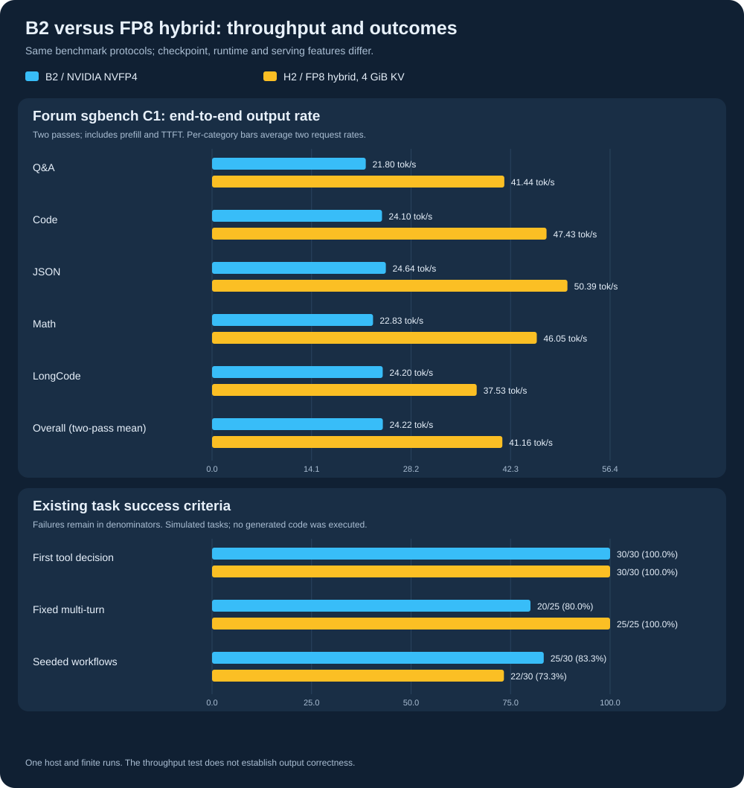
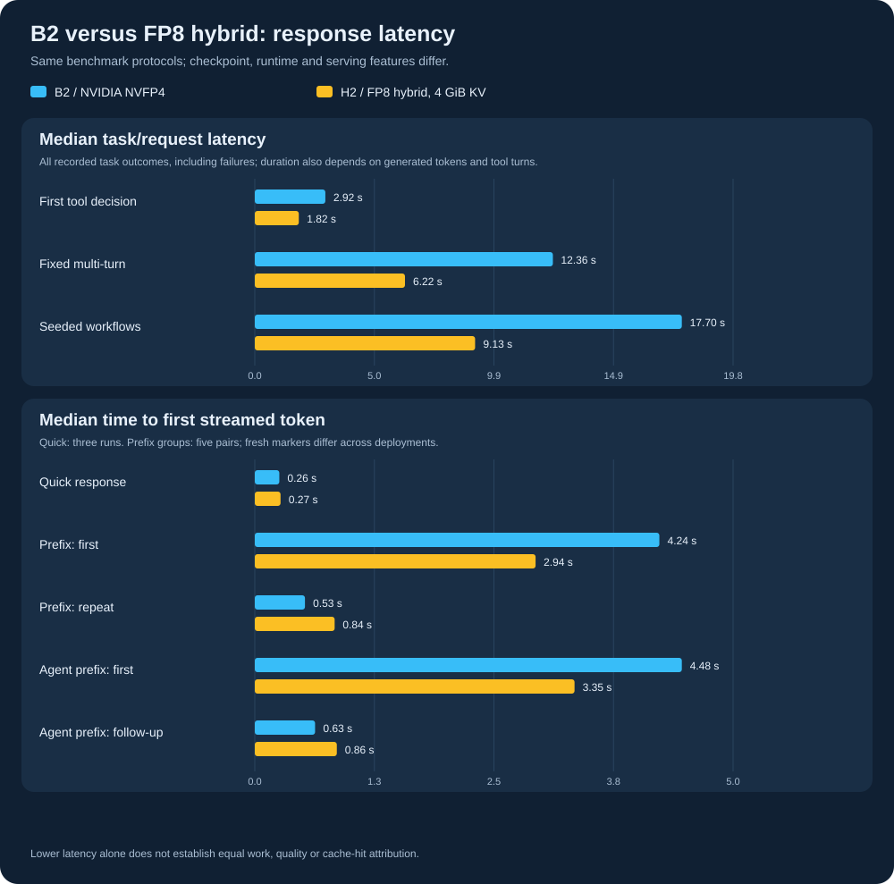
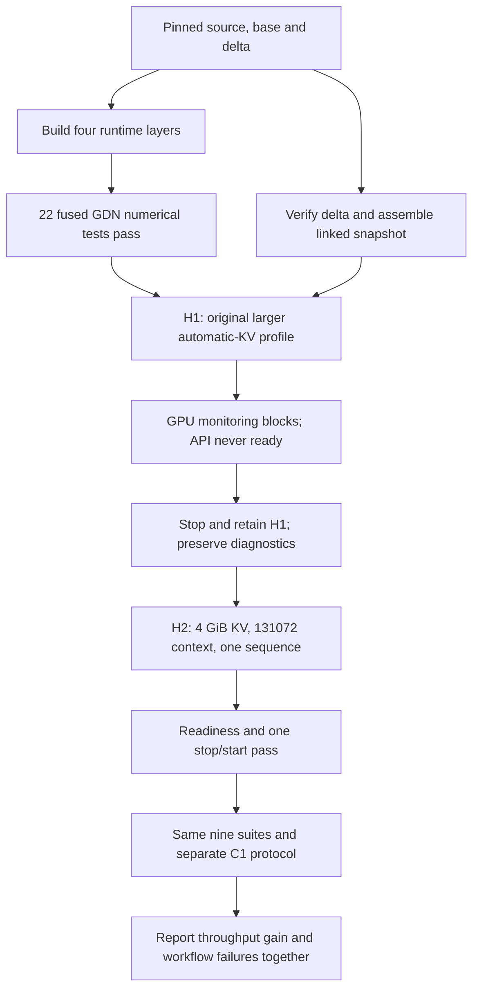
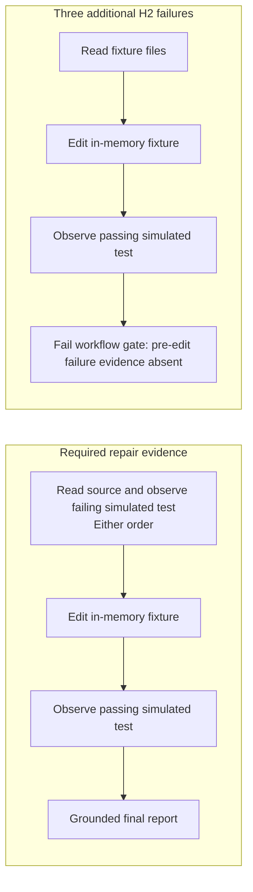

# B2 versus FP8 hybrid: throughput, workflow results and operational limits

On one Jetson AGX Thor, the conservative **H2 FP8-hybrid deployment measured 41.16 tok/s**, versus **24.22 tok/s for B2**, on the same public `sgbench` C1 protocol: a descriptive **1.70× deployment-level difference**. H2 completed more fixed multi-turn cases, but fewer seeded workflow cases. The original larger-memory forum profile did not reach API readiness on this host and was stopped after GPU monitoring became unresponsive.

These are two checkpoint/runtime configurations of **Qwen3.8 Flash Next**, not a ranking of independent model families. No generated code or real repository tests were executed. This report retains the unsuccessful preflight and every measured failure.

## What was compared

| Setting | B2 reference | H2: measured hybrid |
|---|---|---|
| Checkpoint | `local-inference-lab/Qwen3.8-Flash-Next-NVFP4` | Pinned RadixArk NVFP4 base plus FP8 dense-side delta |
| Revision | `6c01ac378d22f6652c9f392c87700496eca8e5dc` | Base `7b719225242aacd3dbd3f9407468c2ee9a9d2594`; delta `358162ffaaeb4372c79843d9cd1f67d3654593da` |
| Runtime | NVIDIA image, vLLM `0.28.1rc1.dev580+g385dce36b` | Custom `sm110-fast-v3`, vLLM `0.1.dev20073+g8e685d198` |
| GPU memory utilization / explicit KV | `0.88` / 4 GiB | `0.88` / 4 GiB |
| Configured context / scheduler slots | `131072` / 1 | `131072` / 1 |
| MTP | Disabled | Three speculative tokens; reduced draft vocabulary |
| Tool parser | `qwen3_xml` | `qwen3_coder` |
| Additional runtime features | NVIDIA baseline implementation | Fused GDN, deterministic QSA, PLE mmap/prefetch, FP8 dense dispatch |
| Power mode | 120 W | 120 W |
| Requests | Sequential | Sequential |

The tokenizer and chat-template files are byte-identical across these checkpoints. Both templates default to **xhigh** thinking when the C1 script supplies no effort override. Repository agent suites explicitly request low effort; reasoning tests separately exercise off/low/medium. Full hashes, image IDs, protocol fingerprints and numeric summaries are in the [reviewed data](../data/fp8-hybrid-comparison.json).

Both engines logged BF16 model dtype. A post-measurement check of each image's `get_kv_cache_torch_dtype` resolver returned BF16 for its `auto` KV setting and logged model dtype. FP8 in this comparison refers to converted weight matrices, not FP8 KV cache.

The measured benchmark commit was `95a19a50473f5b3bda80d2f0d9d5fb77e1a0177e`. Both arms used the same runner hash, Python-source fingerprint, image fixture, generalization implementation, scorer **0.7.3**, protocol **1**, and seed **3628200930879258838**. Historical scorer 0.7.2 results remain separately attributed in the [earlier report](2026-11-08-generalization-followup.md).

## The forum throughput test

We used the public [`sgbench.sh` at revision `584c3e6e6476cb81e913d5b059f12a0b2c4c794d`](https://github.com/azampatti/GB10-3.8-Flash-Next/blob/584c3e6e6476cb81e913d5b059f12a0b2c4c794d/sgbench.sh), changing only its endpoint port: 8000 for B2, 8050 for H2. Source SHA256: `5328e80dd3f8a7115b8732ce313a93faf3078438949085e3b086a83c183d9eaa`.

Each server completed **two passes of five workloads at C1**, with no overlapping benchmark requests. Output caps were Q&A 256, Code 512, JSON 1024, Math 64 and LongCode 2048; temperature was zero. Both servers had already completed the repository suites. There was no separate C1 warmup or cache clearing. The rate includes prefill and time to first token; completion tokens can include reasoning. The script does not grade answer correctness or require a complete program.

| Workload | B2 end-to-end tok/s | H2 end-to-end tok/s |
|---|---:|---:|
| Q&A | 21.80 | 41.44 |
| Code | 24.10 | 47.43 |
| JSON | 24.64 | 50.39 |
| Math | 22.83 | 46.05 |
| LongCode | 24.20 | 37.53 |
| **Overall: mean of two pass rates** | **24.22** | **41.16** |

Per-category rows average their two request rates. Each overall pass rate is `sum(completion_tokens) / sum(request_elapsed_seconds)` across its five workloads; the headline averages the two pass rates. B2 passes were **23.77 / 24.67 tok/s**; H2 passes were **40.84 / 41.49 tok/s**. Pooling all ten requests gives 24.21 / 41.16 tok/s instead. Request durations come from the source script's two-decimal reporting.

This reproduces the cited public throughput protocol on our two deployments. H2 uses different serving limits from the [forum's historical 46.7 tok/s configuration](https://huggingface.co/pastoriomarco/Qwen3.8-Flash-Next-NVFP4-FP8-Hybrid-Delta): one slot, 131072 context, explicit 4 GiB KV and 0.88 utilization. It is not an exact reproduction of that configuration or evidence of a quantization-only speedup.

## All nine repository suites

| Suite | B2 | H2 | Meaning of a pass |
|---|---:|---:|---|
| Quick | 3/3 | 3/3 | API completion with normal stop |
| Reasoning: off / low / medium | 9/9 | 9/9 | Three completed responses per setting; code correctness ungraded |
| Context retrieval | 6/6 | 6/6 | Expected synthetic code retrieved at two prompt sizes |
| Vision | 3/3 | 3/3 | API smoke using the same diagram image; accuracy ungraded |
| Prefix response pairs | 10/10 | 10/10 | Five first/repeat pairs complete |
| Agent-prefix response pairs | 10/10 | 10/10 | Five first/follow-up pairs complete |
| First-decision tool routing | 30/30 | 30/30 | Exact declared tool and argument checks |
| Fixed multi-turn completion | 20/25 | 25/25 | In-memory workflow evidence and final-answer gates |
| Seeded generalization | 25/30 | 22/30 | Same generated variants and evidence/answer gates under scorer 0.7.3 |

Quick, reasoning, context and vision use three recorded repetitions and one excluded warmup per scenario. Prefix suites use five independent pairs and no warmup; their markers differ between deployments by design. Context prompts contained **7,992 and 31,652 actual tokens** in both arms. Repeated context prompts can reuse cache; these are not clean cold-prefill measurements. Configured maximum context and multi-user capacity were not tested.

### What the failures mean

- **Fixed multi-turn:** all four tool-using task families passed 5/5 on both deployments. B2's five failures were the no-tool final-answer gate; H2 passed that case 5/5. A separate post-measurement B2 diagnostic produced a correct-concept, tool-free answer of **725 characters**, exceeding that gate's **500-character** limit. This diagnostic does not retrospectively rescore any recorded episode.
- **Seeded generalization:** both deployments failed all five no-tool cases for exceeding the **700-character** gate. B2 passed the other 25 variants. H2 additionally failed `repair_regression` repetitions **1, 2 and 4**, leaving that family at **2/5**, versus B2's **5/5**.
- Those three hybrid repair traces contain an accepted simulated edit and a passing post-edit simulated test, but omit the required **failing test before the edit**. They are workflow-evidence failures; they are not evidence that three real generated programs failed compilation. All other seeded families passed 5/5 on both deployments. No request errors were recorded in these task suites.

No prompt, tool definition, scorer or result was changed to improve these outcomes, and failing episodes were not rerun for selection.

## Latency and first-token trade-offs

| Median observation | B2 | H2 |
|---|---:|---:|
| Quick complete response | 11.044 s | 6.049 s |
| Quick estimated decode rate | 25.125 tok/s | 53.816 tok/s |
| Quick first streamed token / first visible content | 0.257 / 2.336 s | 0.270 / 1.300 s |
| First tool decision | 2.924 s | 1.825 s |
| Fixed multi-turn task, all outcomes | 12.356 s | 6.225 s |
| Seeded episode, all outcomes | 17.701 s | 9.132 s |
| Repeated-prefix first streamed token | 0.526 s | 0.838 s |
| Agent follow-up first streamed token | 0.632 s | 0.860 s |

H2 finished these responses sooner, while warm first-streamed-token latency was higher in both prefix suites. Visible-content timing also matters: repeated-prefix TTFC was **2.818 / 1.869 s**, and agent-follow-up TTFC was **4.304 / 2.699 s** for B2/H2. TTFT can refer to a hidden reasoning token. Streaming decode is an estimate and speculative multi-token chunks complicate its interpretation; it is separate from the C1 end-to-end rate.

Task medians include failed outcomes. Generated token counts and tool trajectories differ; notably, three H2 repair episodes omitted a required test step. These medians do not establish an equal-work speedup. Prefix counters are server-wide evidence; shorter TTFT alone does not prove cache reuse. See the numeric data for per-suite counters, actual token counts and paired ratios.

## Memory, power and startup

| Recorded observation | B2 | H2 |
|---|---:|---:|
| vLLM-reported model-loading memory | 97.84 GiB | 76.75 GiB |
| KV-token capacity reported at startup | 159,862 | 137,662 |
| Peak host RAM, `tegrastats` reported MB | 117,417 | 98,268 |
| Mean / peak board input during nine-suite window | 64.44 / 99.35 W | 67.77 / 119.21 W |
| Sampled run-window duration | 1,480 s | 783 s |
| Estimated board-input energy in that window | 26.49 Wh | 14.75 Wh |
| Maximum sampled GPU temperature | 61.47 °C | 64.78 °C |

Power and energy cover the nine-suite window, including warmups, and exclude startup and separate C1 runs. Energy integrates successive one-second board-input samples; the maximum observed sample gap was two seconds. This is board input, not GPU-only power. Different outputs, failed episodes and tool paths prevent a correctness-equivalent energy-efficiency claim. Power mode remained 120 W; clocks were not fixed, so these are observed operating conditions.

Reported host RAM includes cache effects. The model-loading memory difference includes checkpoint/runtime and PLE-offload differences; it cannot be attributed solely to dense-weight conversion. H2's 4 GiB cache has less reported token capacity than B2's; both advertised the requested 131072 cap, which was not fully exercised.

### The unsuccessful H1 preflight is part of the result

The pinned recipe defaults (**0.90, automatic KV, 262144 context, three sequences, MTP 3**) loaded weights and selected the expected kernels, then allocated **27.31 GiB KV**. It did not reach API readiness. Kernel logs recorded driver interrupt warnings and blocked GPU-monitor/display tasks; the serving process remained alive without becoming usable. It was deliberately stopped after the host became unresponsive to GPU queries. Exit 137 followed the stop timeout; Docker's OOM flag was false. A driver allocation error recorded at cleanup does not establish the initial cause.

GPU responsiveness returned after stopping H1. H2 was chosen before collecting hybrid benchmark results, using B2's smaller memory/context/scheduler limits and fresh runtime caches. It reached readiness, passed **one deliberate retained-container stop/start cycle**, then completed the measurements. GPU probes guarded preflight and stopped before timed suite measurement. This does not prove long-term stability or identify which changed setting avoided the H1 symptom.

## Decision and reproduction

### Agentic-task recommendation

**Our provisional choice is B2 for unattended tasks that require strict verification order, and H2 for interactive work with human review where response speed matters.** This is an interpretation of the recorded failure costs, not a measured production-reliability ranking. Both deployments selected tools correctly in the routing suite and completed the fixed tool-using workflows. The recommendation turns on the additional seeded repair omissions, not an assumption that faster generation is less reliable.

| Intended use | Provisional choice | Evidence and condition |
|---|---|---|
| Unattended repair with an explicit reproduce-before-edit requirement | B2 as the initial reference | Seeded repair evidence passed 5/5 on B2 and 2/5 on H2. Real-repository validation is still needed before deployment. |
| Interactive coding or exploration with human review | H2 for a faster-response trial | C1 throughput was 1.70× B2 and measured response/task medians were lower; generated-code correctness was not tested. |
| An agent whose trusted runner enforces verification order | H2 is a candidate to evaluate alongside B2 | Such gates could address the observed omission, but a guarded comparison has not been run. Their latency, retries and intervention costs must be measured. |
| A general claim about the better coding agent | Undecided | These public synthetic fixtures do not measure held-out coding correctness or sustained autonomous operation. |

Keep B2 available as a retained alternative. H2's successful smaller-memory profile, custom build dependencies and H1's aborted startup are also part of the operational choice. One successful restart is a finite check, not evidence of unattended uptime over days.

### Why the fixed multi-turn total favors H2

The fixed suite repeats five public fixtures five times. Four fixtures use tools; the fifth asks for a brief answer without tools. Its 25/25 versus 20/25 headline does not mean H2 completed five additional tool workflows:

| Fixed-suite component | B2 | H2 |
|---|---:|---:|
| Four tool-using fixtures, five repetitions each | 20/20 | 20/20 |
| No-tool answer gate | 0/5 | 5/5 |
| **Recorded total** | **20/25** | **25/25** |

H2's entire score advantage is in the no-tool case. B2's saved verdict is the broad `task_incomplete_or_ungrounded` category. The separate 725-character diagnostic demonstrates a brevity violation against the 500-character limit; raw answer text was not retained for the five measured episodes. This supports a short-answer-compliance finding in this fixture, without attributing every original failure to an identical unseen answer or claiming better tool execution.

### Why the seeded total favors B2

The seeded suite is a separate multi-turn protocol. It generates five variants of each of six public task families using the same saved seed for both deployments; paths, values, decoys and recovery conditions can vary. Both suites include a one-turn no-tool control, so neither total consists entirely of multi-turn tool episodes.

| Seeded family | B2 | H2 |
|---|---:|---:|
| Symbol origin | 5/5 | 5/5 |
| Repair regression | 5/5 | 2/5 |
| Moved runbook | 5/5 | 5/5 |
| Transient read recovery | 5/5 | 5/5 |
| Environment disambiguation | 5/5 | 5/5 |
| No-tool answer gate | 0/5 | 0/5 |
| **Recorded total** | **25/30** | **22/30** |

H2's three additional failures are concentrated in one family. The required repair evidence includes reading the relevant source and observing a failing simulated test before editing, followed by a passing simulated test. Reading the source and observing the initial failure may occur in either order. In repetitions 1, 2 and 4, H2 performed the edit and obtained a post-edit pass without recording the initial failing test.

The post-edit passes matter: the experiment did not show three real programs failing compilation, and it did not show that H2 could not make the simulated edit. It showed that H2 omitted a required verification step. For tasks that explicitly require reproducing a regression before editing, that omission is relevant to an unattended workflow. Other task types need their own evidence requirements.

Do not pool the fixed and seeded totals into a single agentic score. They use different protocols, repeated fixtures and success criteria. A brevity violation and a missing verification step need not have the same operational cost. Five variants in a family are a small sample, not five independent real-world projects, and the difference does not establish a statistically reliable general ranking.

### Next controlled study: agents with externally enforced verification

The speed result makes H2 worth testing with a trusted runner that owns the completion gates. **This is proposed work, not an implemented guard or an additional measured result.** Apply the same runner and rules to B2 and H2:

1. Freeze both serving profiles and artifact revisions. Pre-register task selection, fresh seeds, repetitions, output/turn budgets, retry limits, warmup rules and scoring before either deployment runs. Keep existing recorded outcomes unchanged and version the new protocol separately.
2. For repair tasks requiring reproduction, require a task-relevant failing test and source evidence associated with the pre-edit fixture before permitting an edit. Distinguish an expected test failure from an unavailable toolchain or infrastructure error. After an edit, require the relevant passing tests and protected acceptance checks; the model's assertion alone cannot complete the task.
3. Record attempted premature edits, guard rejections, retries, timeouts and human interventions. A runner that blocks an omission has intervened; report that intervention rather than presenting the resulting pass as unassisted model compliance. Give both deployments identical gates and budgets, and retain every failure in its denominator.
4. Measure successful task completion and time to an accepted result, alongside token counts, tool calls, total attempt time and resource use. Account for failed attempts and retries. Do not equate a lower median over episodes that skipped work with a faster correctly completed task.
5. Extend beyond public synthetic templates to held-out tasks in isolated disposable repository fixtures, with real builds/tests and protected checks that cannot be weakened by the agent. Evaluate sustained operation separately. Neither real-code quality nor guarded unattended reliability has been established by the current run.

If H2 retains its speed advantage with comparable accepted-task outcomes and an acceptable intervention cost, it would support choosing H2 for that guarded agent system. If verification omissions continue to consume budgets or cause unacceptable failures, B2 remains the stronger workflow-compliance reference for that requirement. The present data cannot decide that future comparison.

### Reproduction and operating references

Use the [H2 model/build guide](../../models/qwen3.8-flash-next-fp8-hybrid/README.md), [B2 serving command](../SERVING_PROFILES.md#b2-command-memory-fix-with-a-persistent-container), [frozen comparison protocol](../FP8_HYBRID_BENCHMARK_PLAN.md) and [all-suite visual guide](../BENCHMARK_VISUAL_GUIDE.md). H2 serves `qwen3.8-flash-next` at `http://127.0.0.1:8050/v1`. Both containers are retained; start only one model server at a time.

Raw logs, private results and weights remain ignored. Reviewed numeric data and graphs can be regenerated with `scripts/export_deployment_comparison.py` and `scripts/render_deployment_comparison.py`; the checked-in data additionally records reviewed source pins, profile/preflight context and the supplemental diagnostic. Preserve those annotations when updating aggregates.
