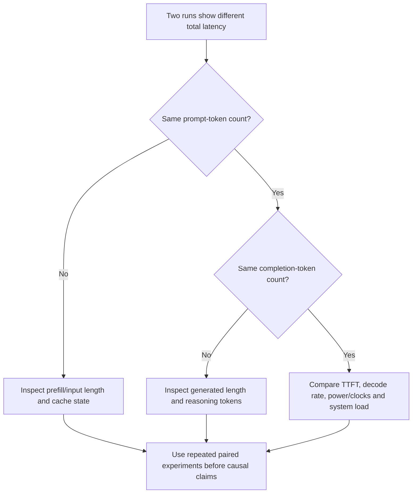

# Shockwave B2: completion length versus input-context latency (2026-11-08)

> **Operator-reported, descriptive evidence.** Single NVIDIA Jetson AGX Thor (128 GB) running Qwen3.8 Flash Next NVFP4 through vLLM. This note records why output-token counts must accompany wall-clock latency comparisons. It does **not** establish that KV-cache tuning caused or eliminated a performance regression.

## Experiment configurations

| Setting | Baseline A | Tuned B2 |
|---|---|---|
| KV memory | 5.26 GiB, automatically allocated | 4 GiB, explicit `--kv-cache-memory-bytes 4294967296` |
| `--gpu-memory-utilization` | 0.90 | 0.88 (still participates in initial free-memory check on the observed build) |
| `--max-model-len` | 212,992 | 131,072 |
| Reported KV token capacity | 214,535 | 159,862 |
| `MemAvailable` single snapshot | 1.1 GiB | 2.9 GiB after benchmarks (3.4 GiB shortly after startup) |
| Tool-routing cases passing | 30/30 | 30/30 |
| Tool-routing median latency | 2.9165 s | 3.1947 s |

Only **the KV budget and context limit together** were intentionally reduced, with a lower startup threshold. Thus this is **not** a single-variable experiment; power/clocks, cache residency, and other running processes were not matched at measurement time. Differences in `free -h` snapshots cannot all be attributed to KV sizing.

## Finding 1 — output length is an important latency confounder

Each row below is the **median** from five runs of the synthetic first-decision tool-routing case, on each deployment. `completion_tokens` includes the model's generated tokens (which may include reasoning); it is not necessarily the number of characters in the visible final answer.

| Scenario | A median completion tokens | B2 median completion tokens | A median latency | B2 median latency |
|---|---:|---:|---:|---:|
| `no_tool_needed` | 94 | 140 | 4.30 s | 6.44 s |
| `run_cache_tests` | 58 | 73 | 2.82 s | 3.59 s |
| `read_agent_protocol` | 64 | 64 | 3.10 s | 3.22 s |
| `read_model_guide` | 58 | 57 | 2.85 s | 2.95 s |
| `search_client` | 59 | 61 | 2.92 s | 3.07 s |
| `search_counter_deltas` | 56 | 58 | 2.76 s | 3.09 s |

- `no_tool_needed`: completion tokens increased **48.9%** (94→140), while total latency increased **49.8%** (4.30→6.44 s).
- `run_cache_tests`: completion tokens increased **25.9%** (58→73), while total latency increased **27.3%** (2.82→3.59 s).
- These proportional movements **strongly suggest generated-output length explains a substantial part** of the two conspicuous latency increases. They do **not** prove equal decode speed or exclude overhead changes: total wall time includes prompt processing, scheduling, prefill and decoding.
- The remaining four cases have similar token counts but small latency increases. We have insufficient controls to assign these to KV allocation, clocks, prompt caching, or run-to-run variability.

**Reporting rule:** publish `prompt_tokens`, `completion_tokens`, TTFT (if streaming), total elapsed, and decode tokens/sec wherever available. Do not interpret total latency as throughput without accounting for generated length. Compare **matched output lengths**, or report performance normalized to tokens *alongside* absolute wall times, with its limitations.

## Finding 2 — longer input alone can increase latency even when output is stable

The tuned B2 `context` suite used non-streaming requests with a deterministic needle-in-haystack target and returned the correct reference code for both probes:

| Scenario | Actual prompt tokens | Completion tokens | End-to-end latency | Passed? |
|---|---:|---:|---:|---|
| `context_8192` | **7,992** | **91** | **9.8524 s** | Yes |
| `context_32768` | **31,652** | **90** | **25.6030 s** | Yes |

The larger probe processed **23,660 additional input tokens** while producing **one fewer completion token**, with end-to-end latency **15.7506 seconds** longer. The output-length explanation for the tool-routing cases cannot explain this difference: increased input-processing work is the leading plausible explanation, although a one-run, non-streaming comparison cannot isolate prefill time, cold-cache effects, or scheduling.

The names `context_8192` and `context_32768` are **approximate test targets**, not actual token counts. Use the server-reported `prompt_tokens` when publishing conclusions. The lack of TTFT and decode tokens/sec in this suite is **expected** because these context probes were non-streaming.

## Latency interpretation workflow

## Provenance and next controls

- A tool-routing samples: `results/20261107T223254Z-tool-routing/samples.jsonl`, reported by the operator.
- B2 tool-routing samples: `results/20261108T015122Z-tool-routing/samples.jsonl`, reported by the operator.
- B2 context samples: `results/20261108T015826Z-context/samples.jsonl`, reported by the operator.
- B2 quick, prefix, and agent runs were also reported as successful; detailed comparisons should remain in a distinct A/B benchmark report.
- All raw `results/` data remain Git-ignored. Only reviewed aggregate/numeric observations appear here.

**Next controlled comparison:** run more matched-size prompts with fixed token ceilings, capture request usage (including reasoning tokens where available), collect clock/power and `MemAvailable` snapshots, and compare at equivalent cache-warmth and concurrency. More than one run per context size is required to characterize variability.

**Decision:** keep B2 as an **experimental, lower-memory profile**, not a universally superior replacement for the higher-context A baseline.
