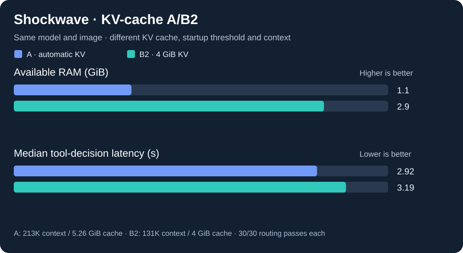

# Jetson AGX Thor: automatic vs. explicit KV-cache allocation (A versus B2)

> Reproducible local **observational** comparison, November 7–8, 2026. The benchmark host used a Jetson AGX Thor 128 GB, Qwen3.8 Flash Next NVFP4, pinned NVIDIA vLLM image digest `sha256:512bf772c7ef221df1a66ab9c95546d77daeba6ba61723692852e6eb0cae7526`, vLLM `0.28.1rc1.dev580+g385dce36b`, power profile previously observed at 120 W (not independently rechecked for B2). Timing samples were provided by the operator, not rerun by CI.

## Key measured tradeoffs

| Quantity | Baseline A | Explicit-KV B2 | Interpretation |
|---|---:|---:|---|
| KV allocation | 5.26 GiB | 4.00 GiB | 1.26 GiB less *nominal cache allocation* |
| `MemAvailable` after workload (single snapshot) | 1.1 GiB | 2.9 GiB | +1.8 GiB observed, not all attributable to KV |
| Max model context | 212,992 | 131,072 | Shorter, capacity changed |
| KV token capacity | 214,535 | 159,862 | Smaller, enough for configured B2 context |
| Tool routing correct | 30/30 | 30/30 | Small synthetic fixture set; no execution |
| Median tool-decision latency | 2.9165 s | 3.1947 s | +9.5%; **completion lengths changed** |
| Prefix repeat TTFT | ~0.51 s | ~0.52 s | Similar on five pairs each |
| Synthetic agent follow-up TTFT | ~0.63 s | ~0.65 s | Similar on five pairs each |
| Prefix decode on repeated request | 24.60 tok/s | ~24.06 tok/s | Small difference, uncontrolled |
| Synthetic agent follow-up decode | 24.58 tok/s | ~23.77 tok/s | Small difference, uncontrolled |

The previous `--gpu-memory-utilization 0.90` **failed** with explicit KV at the initial free-memory gate (109.94 GiB observed vs. 110.52 GiB required). Using `0.88` for B2 passed startup. **It is inaccurate to say manual KV configuration bypasses the initial utilization check** in this pinned build.

## Completed context probes on B2

| Target | Actual input tokens | Generated tokens | Wall-clock latency | Retrieval check |
|---|---:|---:|---:|---|
| 8,192 | 7,992 | 91 | 9.8524 s | PASS |
| 32,768 | 31,652 | 90 | 25.603 s | PASS |

Output lengths are essentially identical, while input length increases by 23,660 tokens; the longer input is the leading plausible contributor to greater time, although these are one-shot *non-streaming* tests and cannot isolate prefill time. This must be distinguished from the tool-routing slowdown where some B2 completions were longer.

## Completion-length confounder

| Synthetic tool case | A completion tokens / latency | B2 completion tokens / latency |
|---|---|---|
| `no_tool_needed` | 94 / 4.30 s | 140 / 6.44 s |
| `run_cache_tests` | 58 / 2.82 s | 73 / 3.59 s |
| `read_agent_protocol` | 64 / 3.10 s | 64 / 3.22 s |
| `read_model_guide` | 58 / 2.85 s | 57 / 2.95 s |
| `search_client` | 59 / 2.92 s | 61 / 3.07 s |
| `search_counter_deltas` | 56 / 2.76 s | 58 / 3.09 s |

End-to-end latency includes prompt processing and token generation. It is **not** decode-only tokens/sec, and completion tokens may include reasoning. Observations are not randomized, measurements of clock activity were unavailable, and system memory snapshots occurred at different times. More controlled testing is needed to claim a speed benefit or penalty from KV sizing alone.

## Data provenance

The operator retained raw results locally under ignored `results/` paths; the tracked report intentionally includes only reviewed numeric summaries:

- A tool-routing: `20261107T223254Z-tool-routing`
- B2 tool-routing: `20261108T015122Z-tool-routing`
- B2 quick: `20261108T015027Z-quick`
- B2 identical prefix: `20261108T015314Z-prefix`
- B2 synthetic agent: `20261108T015408Z-agent`
- B2 context probes: `20261108T015826Z-context`

**Decision:** retain A as the higher-context baseline and B2 as an *experimental* lower-memory option. Do not declare either universally superior. See the [restart/rollback runbook](../MEMORY_AB_EXPERIMENT.md), [tool-routing protocol](../AGENT_TOOL_EVAL.md), and the independent [output-length analysis](2026-11-08-shockwave-b2-output-length-context.md).
