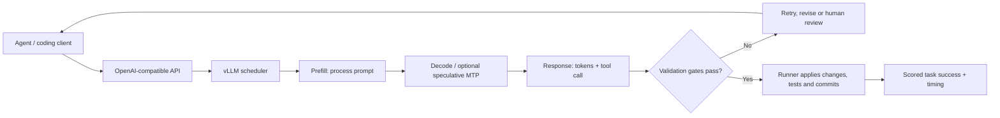

# 01 — Serving, inference and coding-agent lifecycle

| Component | Baseline | Alternate / measurement |
|---|---|---|
| API | `127.0.0.1:8000`, no external access | Remote clients only through authenticated gateway or SSH tunnel |
| Scheduler | `--max-num-seqs 1` | Multi-stream aggregate and per-stream benchmark |
| MTP | Off | Use a fully validated matching draft model |
| Response | HTTP 200, `finish_reason=stop` | **Not** proof generated code passes tests |
| Agent checks | Not implemented by this framework | Sandbox compiler/tests; tool syntax; retries; timeouts; security |

**Product-readiness criteria:** reproducible p50/p95 latency, quality evaluation, per-task success, safe tool execution, failure recovery, queueing and thermal/runtime reliability. Source: [Smithy field report](https://github.com/Divhanthelion/Smithy-Windows/blob/main/reports/2026-09-24-unattended-runs-on-the-thor.md).
