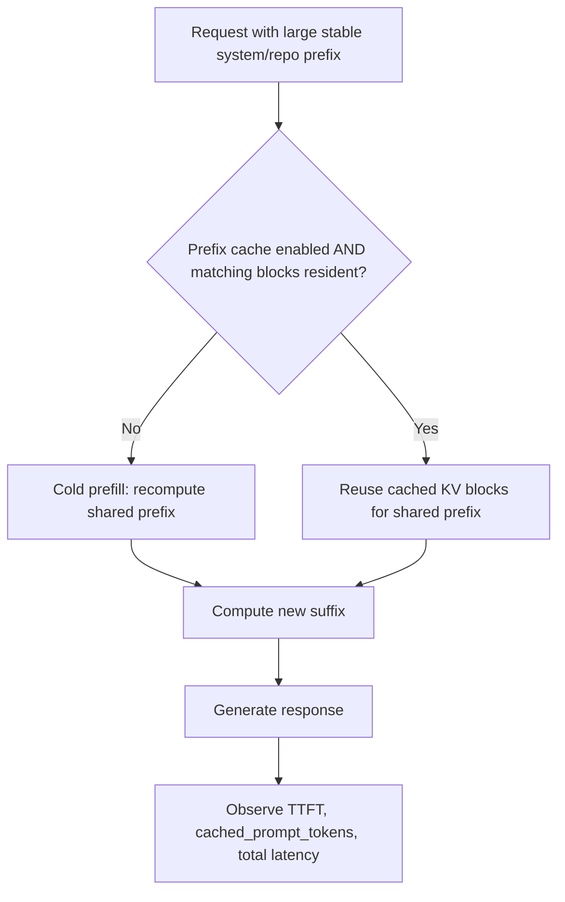

# 02 — Prefix caching: on / off / unspecified



| State | How | Trade-off |
|---|---|---|
| Shockwave v0.2.0 | No explicit prefix flag in `serve.sh`; **do not infer off** | Must inspect engine configuration or measure hit counts |
| Explicitly on | `--enable-prefix-caching` if supported by this exact image | Major repeat TTFT gain on stable prefixes; cache consumes memory |
| Explicitly off | Version-specific disable flag; verify with `vllm serve --help` | Stable cold-start experiments but repeated prefill cost |

**Run now without restarting:**

```bash
python3 -m thorbench bench --suite prefix --runs 1 --warmup 0 \
  --prefix-tokens 8192 --container qwen38-flash-next
```

This sends one synthetic prefix twice with the same prompt. Compare `prefix_first` vs `prefix_repeat` TTFT, TTFC and `cached_prompt_tokens` in `samples.jsonl`. `cached_prompt_tokens` is `null` when the server does not return it; a shorter second request alone is not definitive proof of KV reuse. The randomized run marker lowers—but cannot eliminate—cross-session warm-cache contamination. Results are **not a clean cold-cache benchmark** unless the cache was cleared and verified. [Ryan Johns reported a 16k cold/warm TTFT of 9.05s/1s](https://forums.developer.nvidia.com/t/qwen3-8-flash-next-at-46-7-tok-s-on-jetson-agx-thor/383269/6) on a different stack.
