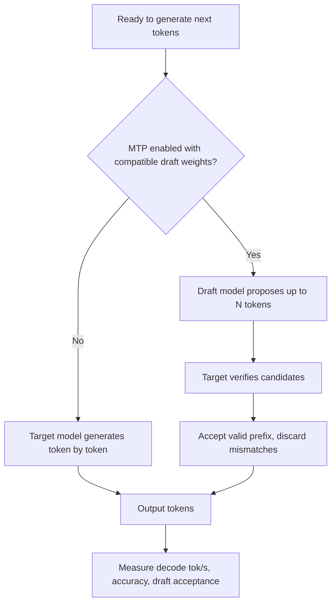

# 03 — MTP speculative decoding

| State | Config | Result / gate |
|---|---|---|
| Baseline | **No `--speculative-config`** | Stable inference (~23–25 tok/s observed intervals) |
| Initial attempted on | `--speculative-config '{"method":"mtp","num_speculative_tokens":3,"model":"/opt/qwen38-mtp-model"}'` | **FAILED** missing `model-00001-of-00034.safetensors` |
| Community custom stack | Embedded/compatible MTP=3 on pinned RadixArk checkpoint | Reported higher throughput; **not plug-and-play** on our image |

Do not add that failed draft path back to `serve.sh`. Track [issue #3](https://github.com/kagaho/jetson-thor-llm-bench/issues/3); only enable after checkpoint integrity, parser/grammar, tool-call quality, deterministic A/B and long-run testing.
