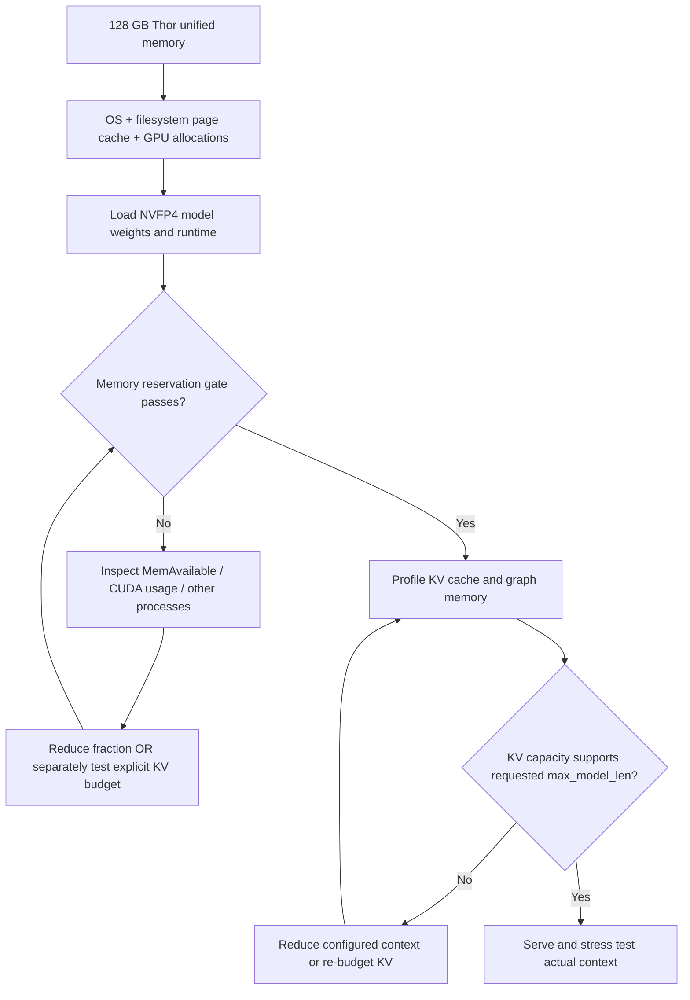

# 04 — Thor unified memory, cache budget and context

| Budget | Baseline | Alternative |
|---|---|---|
| GPU fraction | `--gpu-memory-utilization 0.90` passes | 0.93 failed at first reservation gate |
| KV bytes | Unset; vLLM auto-inferred; ~5.28 GiB free at the 262K failure | The external field report used fixed `--kv-cache-memory-bytes` 8 GiB on a *different* build |
| Max context | `--max-model-len 212992` *advertised*, not fully tested | 262144 requested and failed KV fit at 0.90 |
| `drop_caches` | Manual diagnostic, **not** part of benchmarking | Only reclaim filesystem cache when warranted; does not free live allocations |
| KV dtype | No explicit `--kv-cache-dtype` | BF16 vs FP8 should be controlled for quality + cache capacity |

**Important:** vLLM's `--kv-cache-memory-bytes`, when set, **overrides** the GPU utilization fraction for KV sizing; these flags are *not* simply additive. Monitor memory and test an isolated cold start rather than copying another machine's 8 GiB blindly. [Official vLLM docs](https://docs.vllm.ai/en/v0.28.0/configuration/engine_args/) · [Issue #2](https://github.com/kagaho/jetson-thor-llm-bench/issues/2).
