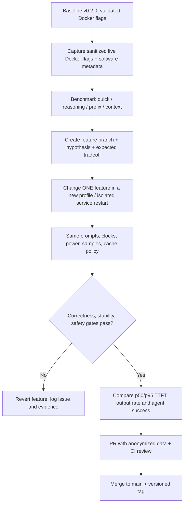

# 05 — Controlled optimization and release workflow

**Don't confuse faster tokens with faster agents:** a response can decode faster and still be unusable due to broken JSON, bad tool arguments, dropped requests, context failures or long-run over-current. Record all separately. `main` remains stable, model profiles remain immutable after publication, and results stay gitignored until anonymized and reviewed.
