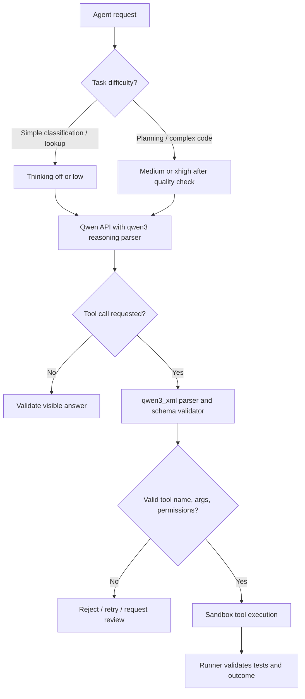

# 06 — Thinking budget and tool-call parser

| Knob | Baseline | Alternative / gate |
|---|---|---|
| `--reasoning-parser` | `qwen3` | Required to separate thinking from visible answer where supported |
| `reasoning_effort` | Per request, `low` on coding smoke test | Off/medium/xhigh; compare token usage and task accuracy |
| `--enable-auto-tool-choice` | On | Allows model tool selection; require external validation of names and args |
| `--tool-call-parser` | `qwen3_xml` | Another stack used `qwen3_coder`; verify model/build compatibility before changing |

A successful HTTP response and `finish_reason=stop` do **not** prove the tool call executed or produced correct changes. Score valid arguments, sandbox execution, checks and recovery separately. Sources: [Smithy field report](https://github.com/Divhanthelion/Smithy-Windows/blob/main/reports/2026-09-24-unattended-runs-on-the-thor.md) and [NemoClaw fast recipe](https://github.com/pastoriomarco/NemoClaw-Thor/blob/main/serving/docs/QWEN38-FLASH-NEXT-FAST-THOR.md).
