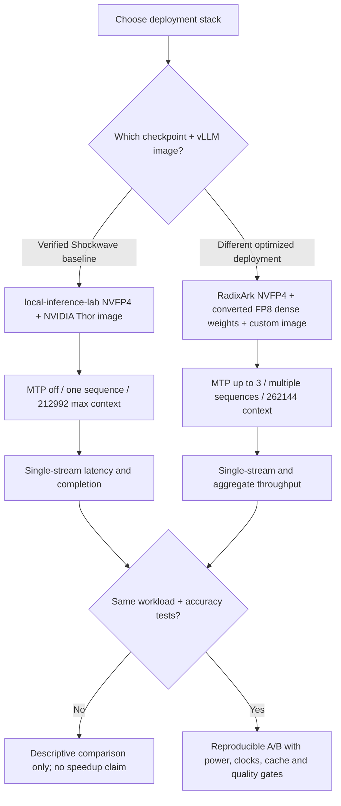

# 07 — Original NVFP4 vs custom FP8-hybrid, one stream vs many

| Feature | Baseline | Fast custom deployment | Gate |
|---|---|---|---|
| Model files | NVIDIA `local-inference-lab` NVFP4 snapshot | Pinned RadixArk routed NVFP4 + FP8 dense-side deltas | Audit licensing, hashes, checkpoint revisions and tool quality |
| Serving engine | NVIDIA Jetson AI Lab image | Locally built patched vLLM (`sm110-fast-v3`) | Reproduce build and kernel correctness |
| Fused GDN / PLE | No claim about effective internal kernels | Fused CUDA GDN, custom mmap/prefetch | Confirm actual kernels and temperature |
| Max sequences | 1 | 3 in Marco/Ryan stack | Record per-request latency **and** aggregate tokens/s |
| MTP | Off | 3 draft tokens | Acceptance, grammar correctness, fallback |
| Context | 212,992 advertised | 262,144 reported | Verify actual long-context reliability |

The 46.7 tok/s claim is Marco's end-to-end output rate for a different `sgbench` C1 mix. Higher concurrency can increase **aggregate** tokens/sec without improving one coding agent's critical-path latency. For agent readiness, require successful multi-turn tool invocations, test execution, long-run uptime and graceful failure behavior. [Original performance report](https://forums.developer.nvidia.com/t/qwen3-8-flash-next-at-46-7-tok-s-on-jetson-agx-thor/383269) · [Pinned custom recipe](https://github.com/pastoriomarco/NemoClaw-Thor/blob/main/serving/docs/QWEN38-FLASH-NEXT-FAST-THOR.md).
