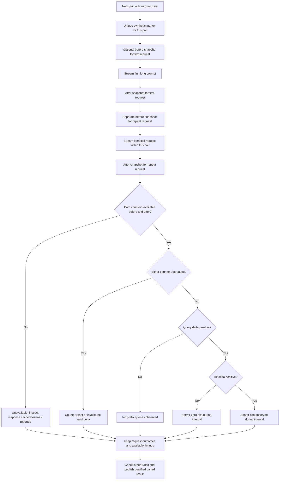

# Prefix cache: observed latency vs verified server evidence

**Evidence rules:** TTFT speedup alone does **not** establish that the model reused KV blocks. `cached_prompt_tokens = null` is missing evidence, not a measured zero. Prometheus `vllm:prefix_cache_hits_total` and `vllm:prefix_cache_queries_total` are cumulative server-level counters; if an unrelated request ran between snapshots, attribution is ambiguous. Exact exporter naming varies by version.

**Counting:** `--runs N` is N independent pairs, or 2N requests, with `--warmup 0`. First is not guaranteed cold: a unique marker does not clear caches or reset kernels. Failed requests remain in scenario pass counts. Only completed pairs with usable TTFT contribute ratios; per-scenario timing medians use successful requests. The median paired ratio need not equal the ratio of marginal medians.

For the [two November 7 pairs](../benchmarks/2026-11-07-shockwave-prefix.md), speedups were observed while cache hits were unverified. The [later five-pair study](../benchmarks/2026-11-07-shockwave-five-pair-prefix-agent.md) recorded positive server-wide hit deltas. These are distinct evidence records, not retroactive cache attribution for the earlier requests.

See the [suite guide](../BENCHMARK_VISUAL_GUIDE.md#prefix-pairs-and-changing-task-pairs) and [report interpretation](21-results-and-evidence.md).

Source: [vLLM metrics](https://docs.vllm.ai/en/stable/usage/metrics/).
