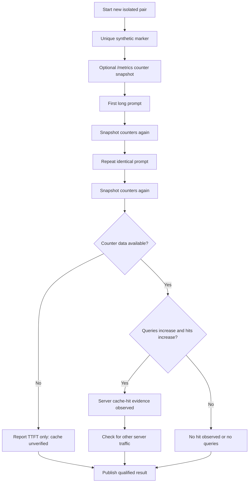

# Prefix cache: observed latency vs verified server evidence

**Evidence rules:** TTFT speedup alone does **not** establish that the model reused KV blocks. `cached_prompt_tokens = null` is missing evidence, not a measured zero. Prometheus `vllm:prefix_cache_hits_total` and `vllm:prefix_cache_queries_total` are cumulative server-level counters; if an unrelated request ran between snapshots, attribution is ambiguous. Exact exporter naming varies by version.

For the [two November 7 Shockwave pairs](../benchmarks/2026-11-07-shockwave-prefix.md), the TTFT speedup is observed but hit counts were unavailable. The new v0.4.0 suite is designed to gather stronger evidence without modifying the running model.

Source: [vLLM metrics](https://docs.vllm.ai/en/stable/usage/metrics/).
