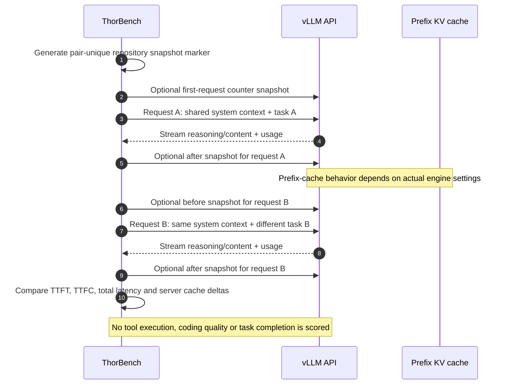

# Agent-style shared-context evaluation (synthetic)

| Feature | First request | Follow-up |
|---|---|---|
| Long shared repository instructions | Same | Same |
| User instruction | Summarize design constraints | Suggest tests for constraints |
| Random marker across pairs | Unique | New marker for next pair |
| Reasoning | Low | Low |
| Temperature | 0.0 | 0.0 |
| Output maximum | 256 tokens | 256 tokens |

**Not a complete agent evaluation.** Real coding agents call tools, modify files, run tests, handle failures, retry, and validate results. This synthetic probe isolates one common agent characteristic: a large stable instruction prefix with a changing task tail. Use the [protocol](../AGENT_BENCHMARK_PROTOCOL.md) and [case study](../benchmarks/2026-11-07-shockwave-five-pair-prefix-agent.md) together.

`--runs N --warmup 0` creates 2N requests. Each pair rebuilds two requests with the same synthetic system context; request B is not a multi-turn transcript containing response A. Completion is checked, but neither suggested tests nor design constraints are semantically scored. The shared context and changed task isolate responsiveness rather than demonstrated tool use.

For actual structured tools, use the separate [routing cases](20-tool-routing-cases.md), [fixed-agent task traces](19-fixed-agent-test-cases.md) or [seeded families](14-generalization-test-families.md). See the [suite map](../BENCHMARK_VISUAL_GUIDE.md#suite-map-and-counting-rules) to choose the correct entry point.
