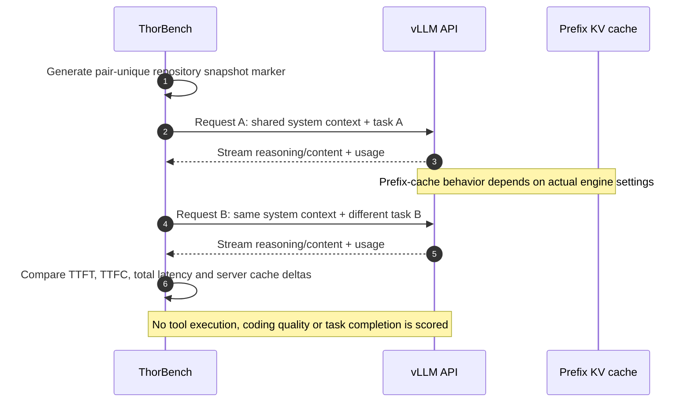

# Agent-style shared-context evaluation (synthetic)

| Feature | First request | Follow-up |
|---|---|---|
| Long shared repository instructions | Same | Same |
| User instruction | Summarize design constraints | Suggest tests for constraints |
| Random marker across pairs | Unique | New marker for next pair |
| Reasoning | Low | Low |
| Temperature | 0.0 | 0.0 |
| Output maximum | 256 tokens | 256 tokens |

**Not a complete agent evaluation.** Real coding agents call tools, modify files, run tests, handle failures, retry, and validate results. This synthetic probe isolates one common agent characteristic: a large stable instruction prefix with a changing task tail. Use the [protocol](../AGENT_BENCHMARK_PROTOCOL.md) and [case study](../benchmarks/2026-11-07-shockwave-prefix.md) together.
