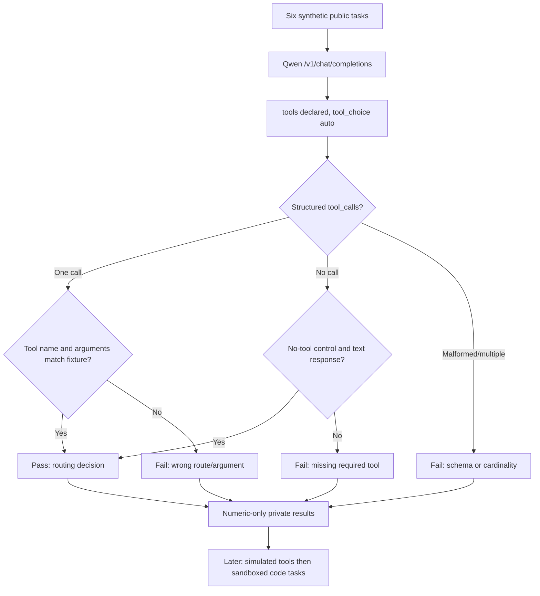

# First tool decision: safe model behavior probe

The three declared tools (`read_file`, `search_repository`, `run_tests`) **are not executed**. The suite tests structured tool-call selection, not end-to-end problem solving or real coding correctness. Unlike the existing latency-oriented `agent` suite, this evaluates the model's decision at an actual tool interface.

See [protocol](../AGENT_TOOL_EVAL.md).
