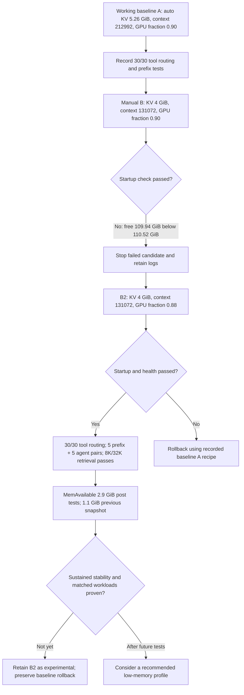

# Shockwave: observed A→B→B2 experiment

This diagram now represents the **observed sequence**, not an unexecuted plan. Cache values and memory numbers are from operator-provided logs; long-term stability is unverified.

**Interpretation:** a manual KV-cache size skipped cache profiling **after** startup, but the observed pinned vLLM build still evaluated the utilization-based initial free-memory gate. Changes to context, KV cache, and startup threshold mean B2 is not a single-variable A/B test.

See [runbook](../MEMORY_AB_EXPERIMENT.md) and [measurements](../benchmarks/2026-11-08-shockwave-b2-vs-a.md).
