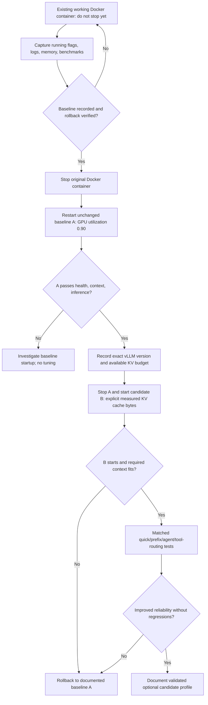

# Controlled memory restart — explicit KV budgeting

**Important:** `--kv-cache-memory-bytes` does not increase physical RAM; where supported it changes how vLLM derives cache size and overrides `--gpu-memory-utilization` for that calculation. Not every version of the specialized NVIDIA Jetson container necessarily supports the same options as upstream vLLM. This flow deliberately does not provide an arbitrary cache-size value.

See [experiment runbook](../MEMORY_AB_EXPERIMENT.md).
