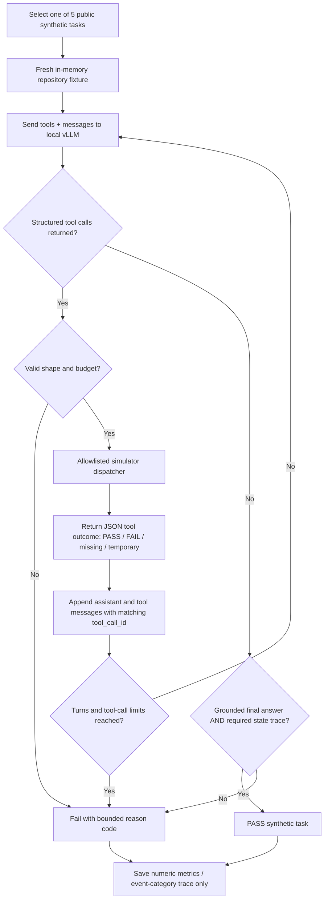

# Multi-turn agent evaluation: safe simulator, not shell execution

**Safety boundary:** The dispatcher operates on a Python dictionary of synthetic fixtures. There is no simulated-to-real filesystem bridge. Calls named `run_tests` and `replace_text` never launch a process or write to source files. Tests validate rejecting arbitrary tool names, paths and edited content.

**Measurement boundary:** Total task latency covers all model requests; completion-token count sums all generated tokens across turns, and prompt-token count includes repeated conversation history. An error recovery is counted only when the simulator recorded both an error and a subsequent successful observation. A final declaration without the required tool evidence is a failure.
