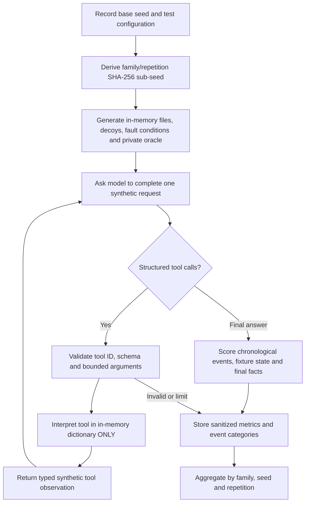

# Seed-varying synthetic agent benchmark — v0.7.0 candidate

**Safety invariant:** no model-generated code, shell commands, real tests, host file edits, or external tool calls. Tool names are allowlisted and their effects are simulated. The sole external dependency is the already-running local model API.

**Evidence limits:** the generator is public and varies task *instances* but not task-family semantics. A high score is not evidence of correct handling of independent unseen coding issues. The next stage must use separately withheld task families and isolated real execution only after security review.
