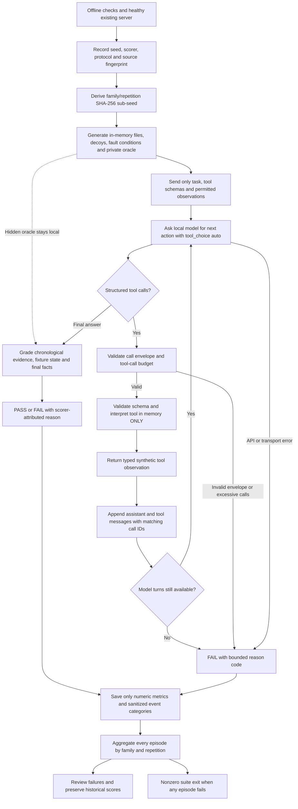

# Seed-varying synthetic agent benchmark — evaluation workflow

**Safety invariant:** no model-generated code, shell commands, real tests, host file edits, or external tool calls. Tool names are allowlisted and their effects are simulated. The sole external dependency is the already-running local model API.

**Protocol:** defaults are 10 model turns, 16 tool calls, `tool_choice=auto` and nonstreaming requests. Validly enveloped calls with invalid tool names/arguments receive typed simulator errors and consume budget. Malformed envelopes, exceeding the call budget or exhausting model turns fail the episode; a final answer can still follow exactly 16 calls when model turns remain. The grading oracle is never included in a model request. Raw prompts, answers, arguments and fixture contents are excluded from reports; request errors remain in the denominator.

**Versions:** the released package v0.7.0 contains scorer 0.7.3 / protocol 1. The recorded 25/30 full run used scorer 0.7.2. New grader corrections require demonstrated positive/negative regressions and a new scorer revision; changes to model prompts require a new protocol version. Neither change rewrites older results.

**Evidence limits:** the generator is public and varies task *instances* but not task-family semantics. A high score is not evidence of correct handling of independent unseen coding issues. The next stage must use separately withheld task families and isolated real execution only after security review.

See the [test-family diagram](14-generalization-test-families.md), [result charts](../AGENT_GENERALIZATION_RESULTS.md) and [scoring contract](../AGENT_GENERALIZATION_EVAL.md).
