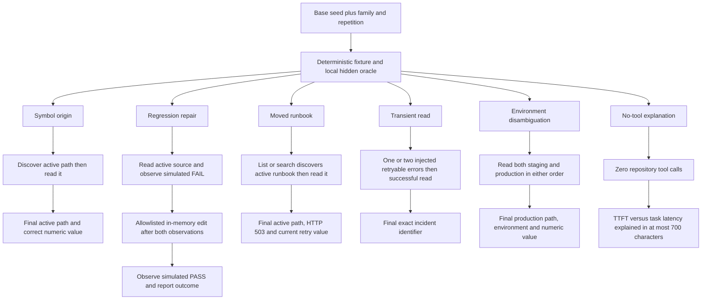

# Seeded generalization: test families and evidence gates

These gates describe the released **scorer 0.7.3 / protocol 1**. Numeric matching uses exact token values, but a correct number mentioned incidentally can still fool the final-answer heuristic. The test families are public templates with generated variants, not independently held-out coding tasks.

The model receives the task and tool observations; the grading oracle remains local. `run_tests` and `replace_text` inspect or mutate fixture dictionaries only. For the moved runbook, opening a link already identified as broken is optional; discovering and reading the active file is required.

Negative controls cover missing discovery, discovery after the last read, archive-only evidence, missing active path or facts, wrong numeric values, unsupported test-pass claims, unnecessary tools and excessive verbosity. A correct final claim alone cannot replace the required observations.

See the [evaluation workflow](13-generalization-seeded-fixtures.md), [scoring contract](../AGENT_GENERALIZATION_EVAL.md), and [recorded outcome and latency charts](../AGENT_GENERALIZATION_RESULTS.md).
