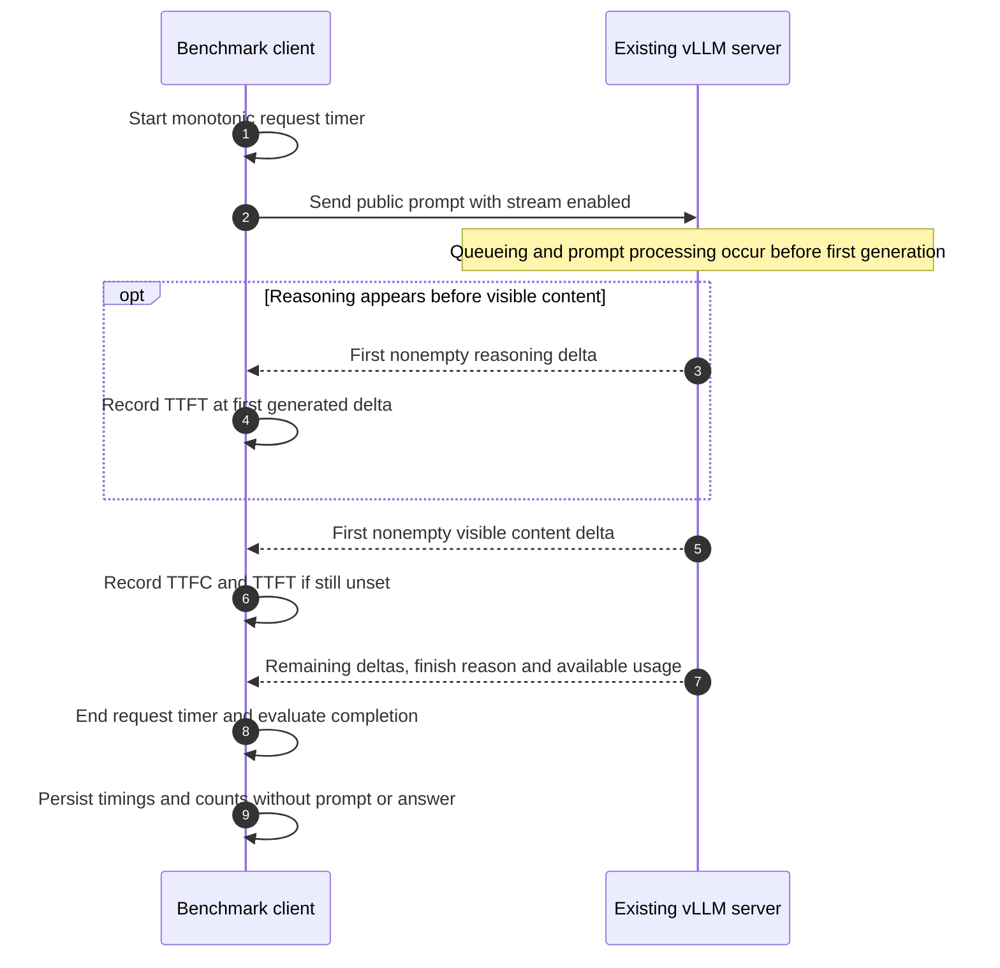
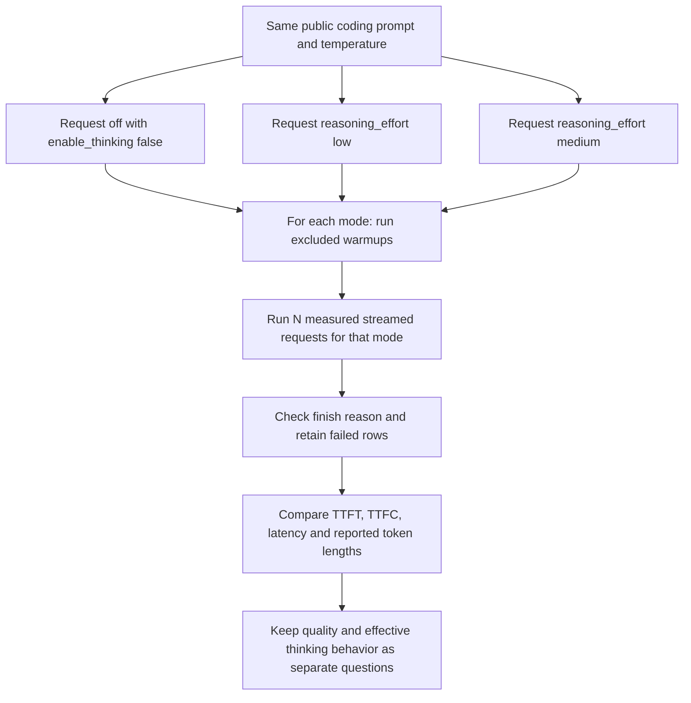

# Streaming timing and reasoning-mode tests

## One streamed request

TTFT is elapsed time to the first nonempty generated SSE delta, including reasoning if present. TTFC is elapsed time to the first visible content delta. They coincide when the first generated delta is visible text. Neither measures model startup; the server is already running. Streaming chunks can contain multiple tokens, so these are observed delta timings.

| Metric | Calculation or observation |
|---|---|
| Request latency | Time from sending the request until its response ends |
| Effective throughput | Reported completion tokens divided by request latency |
| Estimated decode throughput | `(completion_tokens - 1) / (elapsed_s - ttft_s)` when the inputs are available and valid |
| Reasoning tokens | Server-reported usage; included in completion accounting when reported that way |

Missing token usage or timing produces `n/a`, not an invented zero. The quick suite checks `finish_reason=stop`; it does not execute the returned coding solution or check its correctness. The default is one excluded warmup plus three recorded quick requests.

## Reasoning-mode workflow

The CLI runs modes in the order off, low, medium; it is not a randomized experiment. Each mode uses the same output budget, which differs from the quick suite's budget. With `--runs 2 --warmup 1`, there are six recorded requests and three excluded warmups. Server/template support determines whether the requested off switch is honored; the request flag alone does not prove reasoning was disabled.

Longer output or hidden reasoning can explain latency differences. The harness does not grade the coding answers, so this test cannot rank reasoning quality. API or truncation failures remain in the pass denominator. Per-scenario latency medians in the `bench` report use successful rows only.

See the [complete suite guide](../BENCHMARK_VISUAL_GUIDE.md#quick-and-reasoning), [methodology](../METHODOLOGY.md) and [report interpretation](21-results-and-evidence.md).
