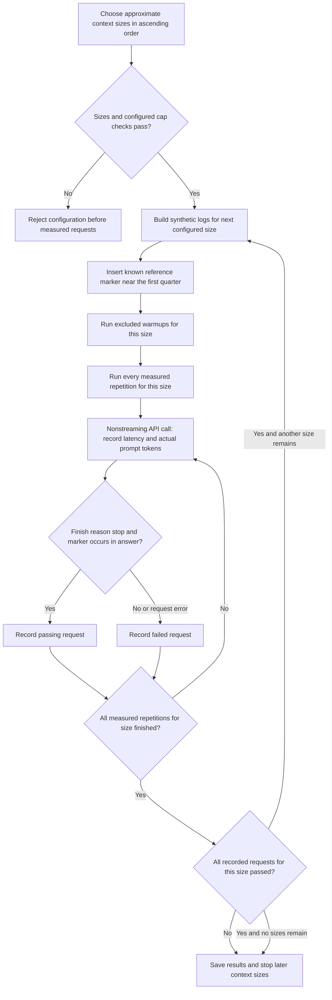

# Context retrieval: input sizes, answer gate and stopping rule

The default targets are 1,024, 4,096 and 8,192 approximate tokens. The builder uses roughly four characters per target token plus instruction overhead; **actual API `prompt_tokens` is the measurement**. Use ascending sizes: the CLI follows the supplied order rather than sorting it.

Targets must be 256–200,000 and below the advertised context cap. Targets above 32,768 require `--allow-large-context`. These checks use approximate targets and do not guarantee the complete tokenized request plus output will fit. A successful configured maximum shown by `/v1/models` is not a successful retrieval measurement.

The public marker is `SW-THOR-7391-ALPHA`. The instruction asks for only the marker, but the current scorer requires **containment**, not an exact whole-answer match. `finish_reason=length` fails even when the marker occurs in partial text. The test checks one narrow retrieval task, not general document comprehension, robustness to all needle positions or independently hidden answers.

All measured repetitions for a size finish before the stop decision. Warmups are excluded from recorded counts. Nonstreaming requests do not measure streamed TTFT/TTFC. For this suite, failures count in the denominator while reported scenario latency medians use successful rows.

Earlier B2 probes at 7,992 and 31,652 actual prompt tokens succeeded; full 131,072-token operation remains unvalidated. See the [recorded probes](../benchmarks/2026-11-08-shockwave-b2-output-length-context.md), [profile limits](../SERVING_PROFILES.md) and [suite guide](../BENCHMARK_VISUAL_GUIDE.md#context-retrieval).
