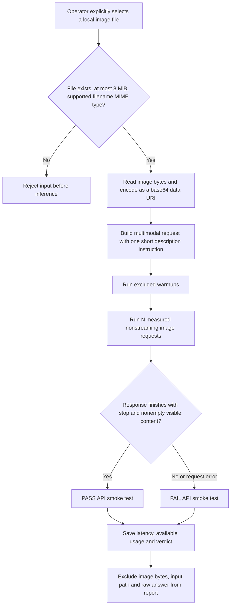

# Vision smoke test: from selected file to API verdict

Supported filename MIME types are JPEG, PNG and WebP. Local validation uses the file name/type and byte size; it does not independently decode or score the image. The configured model server processes the image payload.

The benchmark program reads the file selected with `--image`; this is not a model-selected repository tool or permission for an agent to read arbitrary host files. The simulated-agent evaluators keep their separate in-memory boundary.

PASS establishes API completion and a nonempty visible response. There are no reference labels, semantic image scores, camera-frame-rate measurements or object-detection metrics. Nonstreaming requests provide request latency and available usage, not streamed TTFT/TTFC. Default warmups are excluded, failures remain in request counts and latency summaries use successful rows.

See the [suite guide](../BENCHMARK_VISUAL_GUIDE.md#vision-api-smoke-test) and [methodology](../METHODOLOGY.md).
