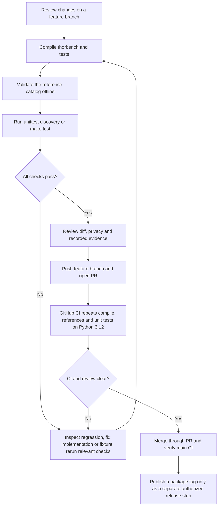

# Offline development tests and CI coverage



The documented baseline at `44d1f0c` has **99 passing Python test methods**, with additional subtests inside some methods. This is an implementation check count, not an LLM completion score. The package declares Python 3.10+ support; the current GitHub workflow exercises Python 3.12 rather than a complete supported-version matrix.

| Coverage | Existing test modules | What is verified |
|---|---|---|
| HTTP and SSE | `test_client.py`, `test_cli_integration.py` | Stream parsing, reasoning/content timing, missing usage, full CLI/report paths against fake local APIs |
| Scenario construction | `test_scenarios.py` | Prompt structure, approximate context, image input rules and paired context construction |
| Cache counters | `test_cache_metrics.py` | Label aggregation, exporter naming, missing data, zero hits and reset detection |
| First tool decision | `test_tool_eval.py` | Tool cardinality, exact schemas/arguments, no-tool decisions and failures in totals |
| Fixed task simulator | `test_agent_eval.py` | Allowlisted effects, recovery traces, bounded loops, unsupported success claims and report privacy |
| Seeded simulator | `test_generalize_eval.py` | Stable seeds, oracle separation, decoys, chronology, numeric false positives, verbosity and safe reports |
| Serving provenance | `test_deployment.py`, `test_model_layout.py`, `test_v05_memory.py` | Sanitized/mocked Docker inspection, public profiles, launch-script declarations and historical memory chart |
| Reports and public evidence | `test_report.py`, `test_case_study.py`, `test_generalization_visuals.py` | Failure denominators, numeric figure provenance, historical scorer labels and exclusion of raw content |
| Reference/version declarations | `test_reference.py` | Public-source caveats, model catalog and declared package version |

No model weights or GPU inference are required. Fake HTTP servers used by integration tests run locally; tests do not benchmark Qwen. Simulator methods named `run_tests` never invoke this real developer test suite. The optional Matplotlib chart renderer is not imported or required by offline tests.

```bash
python3 -m compileall -q thorbench tests
python3 -m thorbench references
make test
git diff --check
```

For live model evidence, choose a separate [benchmark suite](../BENCHMARK_VISUAL_GUIDE.md#suite-map-and-counting-rules). Keeping the offline suite green does not convert a failed model response into a pass. Documentation changes leave the existing `v0.7.0` release tag unchanged.
