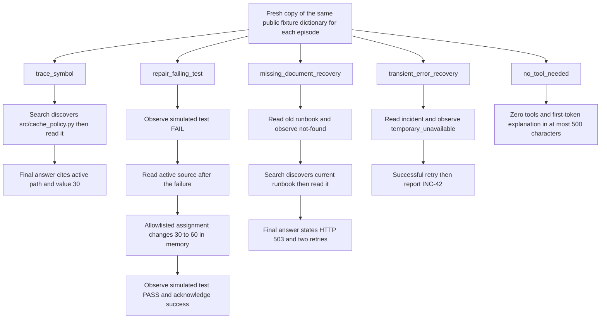

# Five fixed multi-turn tasks and their evidence traces

This is `python3 -m thorbench.agent_eval`. It uses four declared in-memory tools and defaults to eight model turns and twelve tool calls per episode. A final answer may follow exactly twelve calls if model turns remain; attempts to exceed the budget fail. See the [model/tool execution loop](12-multi-turn-simulator.md).

The fixed repair task's required trace is **FAIL → read → edit → PASS**. The seeded repair family accepts reading before or after the initial failing test, provided both precede the edit. The fixed moved-document task requires observing the missing old path; the seeded runbook family accepts direct active-file discovery. These are different scoring contracts, not interchangeable procedural rules.

The recorded 25/25 result represents five repetitions of these five fixtures. Files, expected values and incident IDs stay fixed; each episode still gets isolated mutable state. A simulated PASS only establishes the allowed dictionary assignment and recorded test observation. It does not execute a Python test, apply a real patch or measure real-repository correctness.

Final-answer checks are phrase/substring heuristics. The 500-character fixed-task no-tool cap differs from the seeded family's 700-character cap; the first-decision suite has a different no-tool gate again. Preserve those distinctions in reports and comparisons.

See the [fixed-task protocol](../AGENT_MULTI_TURN_EVAL.md), [observed 25-episode report](../benchmarks/2026-11-08-shockwave-multiturn-25-episodes.md), [seeded family map](14-generalization-test-families.md) and [suite guide](../BENCHMARK_VISUAL_GUIDE.md#fixed-multi-turn-simulated-tasks).
