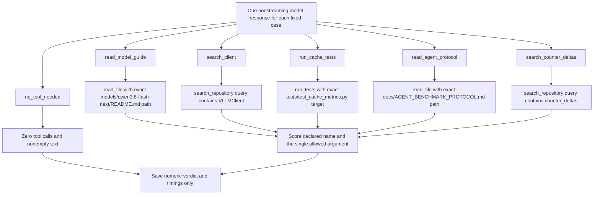

# Six first-decision tool-routing cases

This is `python3 -m thorbench.tool_eval`. Exactly one structured call is required for each repository-action case. Search queries may include additional text as long as they contain the case-sensitive expected identifier; read/test paths must match exactly. The argument object must contain only the declared expected key with a string value.

**No selected tool executes.** Selecting `run_tests` does not run `tests/test_cache_metrics.py`; even the paths in the task are decision fixtures, not permission for the model to touch the checkout. Malformed/multiple calls, wrong function/arguments and request errors count as failures. A textual function-call imitation does not substitute for structured `tool_calls`.

`tool_choice=auto` preserves the no-tool control. That control checks zero calls and nonempty text, not factual accuracy, one-sentence compliance or the fixed/seeded simulator's character caps. This scorer evaluates the response's tool structure; it does not use the ordinary `bench` suites' `finish_reason=stop` completion gate.

Historical 30/30 runs on A and B2 repeat six public cases five times each. They do not establish multi-step task completion, actual test execution or 30 unrelated fixes. The full-request timings include any internal reasoning, and this nonstreaming suite has no streamed TTFT/TTFC measurement.

See the [decision flow](10-agent-tool-evaluation.md), [routing protocol](../AGENT_TOOL_EVAL.md) and [suite guide](../BENCHMARK_VISUAL_GUIDE.md#first-decision-tool-routing).
