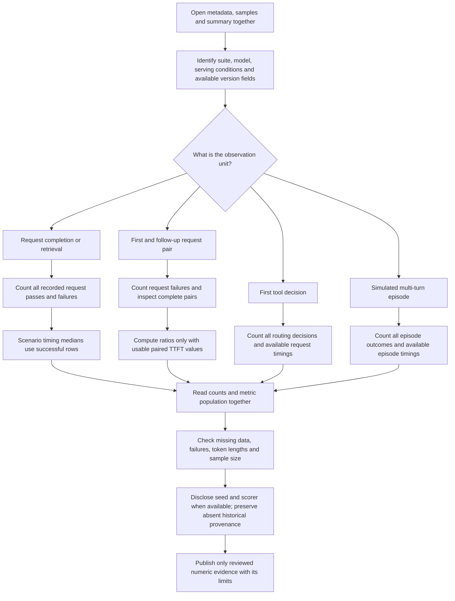

# Reading reports without mixing evidence

## Report files

| File | Read it for | Avoid inferring |
|---|---|---|
| `metadata.json` | Suite identity, selected model, run options and available serving/scorer provenance | That a declared launch recipe is the running configuration, or that older reports contain newer version fields |
| `samples.jsonl` | Every recorded request/episode, verdict, available usage, errors and safe traces | That missing usage is zero, or that a synthetic tool result came from a real shell/test |
| `summary.json` / `summary.md` | Grouped counts, metrics and any paired comparisons | That all suites aggregate the same populations, or that a median ratio equals a ratio of medians |

For `thorbench bench`, warmups are excluded and failures remain in pass/total counts. Per-scenario timing summaries use successful rows. A failed or incomplete pair does not contribute a paired TTFT ratio; completed pairs also need usable positive follow-up TTFT. Report unsuccessful requests alongside the valid-pair sample rather than presenting only the retained ratios.

The separate tool/agent evaluators include numeric timings from failed cases/episodes in their medians. Seeded p90 uses linear interpolation over the observed sample. Five samples per family is a small descriptive sample. Token usage across a multi-turn episode repeats conversation history and is not unique context size. Nonstreaming episode latency is not TTFT.

The recorded seeded 25/30 is scorer 0.7.2 evidence. Package v0.7.0 contains scorer 0.7.3; old answers were not persisted and cannot be regraded from numeric-only summaries. Changing the scorer or model prompt must not quietly relabel earlier observations. A new prompt protocol needs a separate recorded identifier.

Cache-hit counters are server-wide. A faster response alone is not cache attribution. A memory snapshot is not sustained headroom or maximum-context validation. A completion, routing or simulator PASS is not independently verified coding correctness. See the [cache decision tree](08-prefix-cache-evidence.md), [suite map](../BENCHMARK_VISUAL_GUIDE.md#suite-map-and-counting-rules) and [versioned result charts](../AGENT_GENERALIZATION_RESULTS.md).
